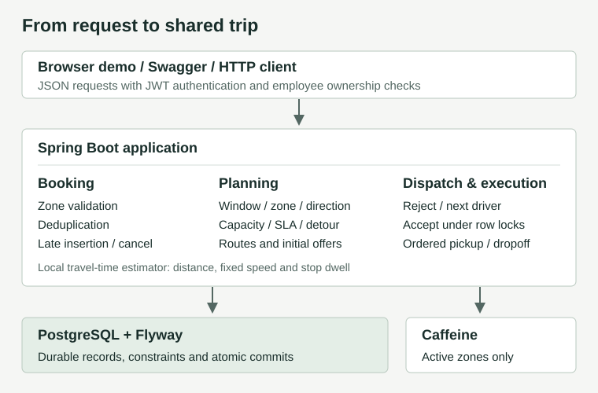

# SLA-Aware Ride Batching

A Java backend that groups employee ride requests into shared trips while enforcing estimated pickup deadlines, seat capacity and rider detour limits.

**Start here:** [run from a fresh clone](docs/local-development.md) · [inspect a real workflow](docs/reviewer-guide.md) · [requirements and evidence](docs/requirements-traceability.md)

## The problem

Ad-hoc employee pickups can create unnecessary cab journeys. Nearby pickups and similar destinations suggest sharing, but the extra stops may delay a rider, exceed seats or cause an unacceptable detour. This project implements the backend for the On-Demand Ride Batching case study.

**Batching is an optimization. SLA, capacity and correctness are hard constraints.** A shared route must pass all three for every rider. If no insertion fits, the planner evaluates a separate trip. If even a solo pickup promise is already missed, the request stays pending with a persisted SLA issue rather than receiving a false confirmation.

## What works

| Area | Behaviour |
| --- | --- |
| Booking | Authenticated creation, pickup-zone validation, logical deduplication, retrieval and cancellation |
| Collection | Bounded PostgreSQL claims; fixed UTC windows; urgent release; zone/direction grouping |
| Planning | Cheapest feasible insertion, four-seat occupancy, pickup SLA and relative/absolute detour checks |
| Dispatch | Initial eligible-driver offer, rejection/cool-off, next untried driver, expiry, bounded attempts and atomic acceptance |
| Lifecycle | Late insertion into planned trips; cancellation replan; ordered pickup/dropoff and driver release |
| Inspection | Grouped booking IDs, ordered stops, occupancy, saved pickup estimates/deadlines and hypothetical rejection examples |
| Operations | Health/readiness, Micrometer/Prometheus, correlation logging and persisted open SLA issues |

Driver responses and execution are **authenticated admin simulations**. There is no separate driver app or notification delivery. An interactive console at `/` provides a clean walkthrough of the backend flow, while Swagger UI provides the complete API reference.

## Architecture



One Spring Boot process coordinates booking, planning and dispatch. PostgreSQL owns durable state, locks and uniqueness; Caffeine caches only active service zones. No external routing provider or messaging infrastructure is required. [Code boundaries and transaction flow](docs/architecture.md).

## Batching algorithm

1. Capture one cycle time; separately escalate expired pending requests.
2. Claim at most 100 eligible pending bookings using `FOR UPDATE SKIP LOCKED`.
3. Partition by 15-minute source window, active pickup zone and compatible leader bearing.
4. Process each cluster by pickup deadline. Explore pickup/dropoff insertion positions while preserving existing stop order.
5. Choose the cheapest insertion that passes structure, peak occupancy, every pickup deadline and every rider's detour. Otherwise try a solo route.
6. Persist routes, booking confirmations and initial driver offers in one transaction.

An open window releases a request early when its pickup deadline is within the five-minute urgency guard. Manual triggers respect that policy. Capacity bounds **simultaneous riders**, not total bookings: turnover can allow more than four bookings on a four-seat route. [Boundary rules](docs/batching-strategy.md) · [search and ETA](docs/planner-and-eta.md) · [complexity](docs/algorithm-analysis.md).

## Correctness under concurrency

- A partial unique index arbitrates active logical duplicates. `INSERT ON CONFLICT` lets the losing request return the existing booking without poisoning its transaction.
- Batching workers claim different rows with `SKIP LOCKED`; route creation and confirmation commit together.
- Late insertion locks and reloads the selected trip, then repeats feasibility against its current riders.
- Acceptance locks trip, offer and driver, rechecks current approach/SLA/capacity/detour, and commits the matching assignment atomically. Provisional offers do not reserve a driver.
- Cancellation removes only the affected rider's stops, recomputes that route's estimates and leaves unrelated trips unchanged. It closes for the whole trip at first pickup.

PostgreSQL integration tests force competing operations into real lock waits and inspect committed state. They cover concrete races and rollback, not every possible interleaving or crash recovery. [Mechanisms, evidence and failure policy](docs/failure-modes.md).

## Technology choices

| Choice | Reason |
| --- | --- |
| Java 17 / Spring Boot 3 | One application with explicit HTTP, security and transaction boundaries |
| PostgreSQL 16 / Flyway / JPA | Database constraints and row locks arbitrate races; migrations own schema and Hibernate validates it |
| Testcontainers / JUnit 5 | Exercise the same database semantics rather than substituting an in-memory database |
| Caffeine | Small, local active-zone cache; mutable assignments remain transactional |
| Springdoc / Actuator / Micrometer | Inspect API contracts and operational signals; a dependency-free reviewer page makes the workflow easier to follow |

CI builds on Java 21; Java 17 remains the compilation target. Maven Wrapper pins the build tooling.

## Run from a fresh clone

Prerequisites: JDK 17+, Docker with Compose, and Python 3.10+ for the HTTP walkthrough. No `.env` or private files are needed for the disposable setup.

```sh
git clone https://github.com/aakash-kr-7/sla-aware-ride-batching.git
cd sla-aware-ride-batching
docker compose -f compose.local.yml up -d --wait
```

Keep the application running in this terminal:

```powershell
# Windows PowerShell
.\mvnw.cmd spring-boot:run '-Dspring-boot.run.profiles=local-fixtures'
```

Linux/macOS: `./mvnw spring-boot:run -Dspring-boot.run.profiles=local-fixtures`.

Open the [backend walkthrough](http://127.0.0.1:8080/) or [Swagger UI](http://127.0.0.1:8080/swagger-ui/index.html). The explicit fixture profile supplies disposable accounts, zones and drivers in its own local database. **Normal startup creates no business fixtures.** This profile changes only the local urgent lead time and offer lifetime to make a short walkthrough practical; hard route constraints remain enabled. [Credentials, policy differences, normal startup and reset](docs/local-development.md).

## Run tests

```powershell
.\mvnw.cmd clean verify
```

Linux/macOS: `./mvnw clean verify`. Docker must be running; PostgreSQL Testcontainers start automatically. No Compose fixture database or credentials are required. CI runs the same clean build/test lifecycle. [Test matrix and focused commands](docs/test-matrix.md).

## Quick review

For an interactive browser walkthrough, open `http://127.0.0.1:8080/`, click **Auto-fill Test Credentials**, and click **Connect & Sign In**. Follow the 8 sequential stages: each action executes live backend APIs, displaying real routes, capacity limits, pickup deadlines, and driver offers in real time. A top-right button links directly to Swagger UI at any time. [Console Guide](docs/reviewer-ui.md).

The browser and Python paths both mutate the same database. Choose one on a fresh setup; reset database volume before repeating the scenario.

For the automated path, in a second terminal at the repository root:

```sh
python scripts/local-review.py
```

This uses real HTTP requests and asserts five distinct bookings, deduplication, a useful zone error, **four-plus-one**, capacity/SLA rejection examples, rejection selecting another driver, acceptance, cancellation isolation and metrics. Actual responses go to ignored `target/local-review/`; no outputs are fabricated or committed.

For a 6–10 minute explanation, use `--pause` on a fresh local database and follow the [review guide](docs/reviewer-guide.md). It identifies the Swagger fields and screenshots worth capturing. The default run finishes with three riders on the affected trip after cancellation; saved responses retain the earlier four-plus-one state.

## Documentation map

| Read this | To understand |
| --- | --- |
| [Local setup](docs/local-development.md), [review guide](docs/reviewer-guide.md), [browser walkthrough](docs/reviewer-ui.md) | Start, inspect, record and reset the public workflow |
| [Architecture](docs/architecture.md), [domain model](docs/domain-model.md) | Packages, relationships and reachable states |
| [Batching strategy](docs/batching-strategy.md), [planner and ETA](docs/planner-and-eta.md) | Collection boundaries, clustering, feasible search and timing |
| [API reference](docs/api-design.md), [trip inspection](docs/trip-inspection.md) | Authentication, operations, response fields and rejection examples |
| [Dispatch](docs/dispatch-workflow.md), [booking lifecycle](docs/booking-lifecycle.md) | Offers, acceptance, execution, cancellation and SLA recovery |
| [Failure modes](docs/failure-modes.md), [test matrix](docs/test-matrix.md) | Locking, rollback, metrics and what tests establish |
| [Requirement traceability](docs/requirements-traceability.md) | Each case-study requirement linked to implementation and tests |
| [Assumptions](docs/assumptions.md), [algorithm analysis](docs/algorithm-analysis.md) | Chosen policies, approximations and costs |
| [Design decisions](docs/decisions/0005-handle-booking-deduplication.md) | [Deduplication](docs/decisions/0005-handle-booking-deduplication.md), [clustering](docs/decisions/0006-request-clustering.md), [zone caching](docs/decisions/007-zone-caching.md) |

Source is in `src/main`, tests in `src/test`, and optional JMH source in `src/benchmark`. [Historical benchmark notes](docs/benchmarks/batching.md) predate the current planner and are not current performance claims.

## Known limitations

- ETA uses straight-line distance, fixed speed/circuity and dwell. Driver approach is checked, but traffic, road networks and actual arrivals are not measured.
- Greedy grouping and preserved stop order do not find a global optimum. Claim limits and competing workers can fragment clusters; late-insertion/fleet scans and route length remain unbounded.
- Urgency does not guarantee service under overload or downtime. Persisted SLA issues and exhausted dispatch attempts still need operational remedies; there is no resolution/reassignment API.
- Driver responses and execution use admin simulation. Offers are provisional; late insertion is restricted to planned trips, cancellation to pre-execution trips.
- Saved estimates are not live promises. Inspection comparisons check current route constraints, not historical decisions or the source-window/zone/direction prefilter.
- Zone caching has no cross-instance invalidation. Actuator is public under this assessment policy. Backup/restore and sustained-load guarantees are unverified; inconsistent legacy data may require explicit repair before migration.

## Further production work

Add authenticated driver execution and measured arrivals, operational SLA remedies and calibrated road ETA. Then validate load, recovery, operational access and cache coherence against an actual deployment. Those are separate steps beyond this case study.
