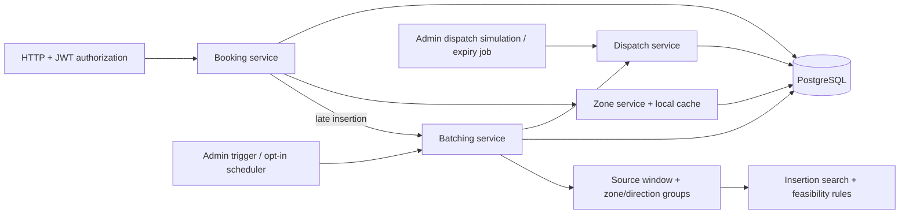

# SLA-Aware Ride Batching

A Java Spring Boot backend that combines employee ride requests into shared trips while enforcing modelled pickup deadlines, seat capacity and rider detour limits.

Jump to the [algorithm](#batching-algorithm), [tests](#how-to-run-tests) or [local setup](docs/local-development.md).

## Problem

Ad-hoc employee pickups can produce unnecessary cab journeys. Nearby pickups and similar destinations suggest sharing, but a shared route may delay an urgent rider, exceed seats or introduce an unacceptable detour. This repository implements the core On-Demand Ride Batching case study.

## The important insight

**Batching is an optimization; SLA, capacity and correctness are hard constraints.** The planner checks every rider before accepting a route. If sharing fails, it evaluates a solo trip; if its solo pickup promise is already missed, the booking stays pending with one open SLA escalation.

## What the system supports

| Area | Implemented scope |
| --- | --- |
| Bookings | Authenticated creation, pickup-zone validation, logical deduplication, retrieval, pagination and cancellation |
| Planning | Bounded closed-window/urgent claims; zone/direction grouping; manual or opt-in scheduled cycles; capacity, pickup SLA and detour checks |
| Trip mutation | Late insertion into planned trips; pre-execution cancellation removes stops and recomputes arrival estimates on the affected route |
| Dispatch | Automatic initial offers, rejection/expiry re-offering, bounded attempts and atomic acceptance; authenticated admin simulation controls |
| Lifecycle | Confirmed route, accepted driver, ordered pickup/dropoff, trip completion and driver release; admin execution simulation |
| Operations | PostgreSQL persistence, Flyway migrations, JWT ownership/role checks, zone caching, health, metrics and Prometheus |

The [requirements matrix](docs/requirements-traceability.md) links these claims to implementation, tests and explicit limitations.

## Architecture

One Spring Boot process owns HTTP, planning and persistence. Feature packages share transactions and repositories.



New trips attempt their initial offer in the planning transaction. Rejection and expiry consider the next untried eligible driver, up to three offers per trip by default. See the [offer workflow](docs/dispatch-workflow.md) for outcomes, HTTP controls and tests. Key code: [BatchPlanner](src/main/java/com/ridebatching/batching/BatchPlanner.java), [TripFeasibilityEvaluator](src/main/java/com/ridebatching/batching/evaluator/TripFeasibilityEvaluator.java), [BookingService](src/main/java/com/ridebatching/booking/BookingService.java), [DispatchService](src/main/java/com/ridebatching/dispatch/DispatchService.java).

## Batching algorithm

1. Claim at most 100 eligible bookings with PostgreSQL `FOR UPDATE SKIP LOCKED`, ordered by deadline, creation time and ID. Fixed UTC windows normally close after 15 minutes; requests within five minutes of their deadline can leave collection early. Expired requests remain pending, excluded from planning claims; a separate bounded pass persists missed-promise escalations.
2. Partition by source window, active pickup zone and compatible leader direction, then sort each cluster by pickup deadline and booking ID.
3. Enumerate pickup/dropoff insertion positions while preserving each existing trip's stop order.
4. Choose the cheapest feasible insertion per trip, checking alternatives against: route structure, peak occupancy, every pickup deadline and every rider's detour.
5. Choose the feasible trip with the smallest added estimated duration; otherwise check a solo route or leave the request pending.
6. Persist routes, confirmed booking associations and initial driver offers in one transaction. No eligible driver leaves a planned trip visible for inspection/retry.

The search checks alternative insertions while preserving existing stop order. This greedy choice is not a global optimum. Random trip UUIDs also affect equal-cost ties across fresh runs. See [strategy](docs/batching-strategy.md) and [complexity](docs/algorithm-analysis.md).

## Correctness and concurrency

- **Duplicates:** a partial unique index protects active keys. `INSERT … ON CONFLICT DO NOTHING` preserves a usable creation transaction; a duplicate returns the existing booking.
- **Competing batch workers:** locked rows are skipped; trip persistence and booking confirmation commit or roll back together.
- **Route mutations:** creation/insertion are atomic. Insertion and cancellation lock booking before trip; insertion reloads and rechecks current riders/state.
- **Driver assignment:** acceptance locks trip, offer and driver, then rechecks eligibility and actual seat capacity, current pickup SLA/detour and driver approach. Offer creation and responses serialize on the trip; only one live offer is returned. Acceptance at/after expiry fails, and driver versions reject stale detached updates.
- **Lifecycle:** pickup requires the accepted driver and next route stop. The first pickup closes cancellation for the entire trip. Execution and cancellation serialize on the trip; one OPEN escalation per booking/reason is enforced by a partial unique index.
- **Stored invariants:** foreign keys and deferred stop uniqueness protect committed state. Empty-trip cancellation releases its driver and expires outstanding offers.

PostgreSQL tests force these races and check committed outcomes. They cover concrete interleavings, not every possible execution. See [test evidence](docs/test-matrix.md) and [failure boundaries](docs/failure-modes.md).

## Technology choices

| Choice | Reason |
| --- | --- |
| Java 17 / Spring Boot 3 | Explicit domain types and inspectable HTTP, authorization and transaction wiring; CI uses Java 21 |
| PostgreSQL 16 / Flyway / JPA | Constraints and row locks arbitrate races; migrations own the schema and Hibernate validates it |
| JUnit / Testcontainers | Algorithm tests plus real PostgreSQL integration tests, including migrations and rollback; no H2 substitution |
| JWT / BCrypt | Stateless request authentication, encoded account passwords and current-account ownership/role checks |
| Caffeine | Cache active-zone lookups locally; repository writes evict after commit, while external writers remain a staleness limitation |
| Micrometer / Actuator / springdoc | Inspect health, event counters, candidate rejection counts and generated HTTP contracts |

## How to run

Requires JDK 17+ and Docker with Compose. Maven is supplied by the wrapper; first use downloads dependencies and container images.

```sh
git clone https://github.com/aakash-kr-7/sla-aware-ride-batching.git
cd sla-aware-ride-batching
```

Follow [local setup](docs/local-development.md): supply DB/JWT values, start PostgreSQL and explicitly enable admin bootstrap if needed. Startup creates no business records; employee/zone/driver provisioning has no HTTP API. Normal app port: 8080. Swagger: `http://127.0.0.1:8080/swagger-ui/index.html`.

## How to run tests

```sh
./mvnw clean verify
```

On PowerShell use `./mvnw.cmd clean verify`. This runs the full suite and packages the executable JAR under `target/`. Integration tests use disposable PostgreSQL Testcontainers databases, independent of Compose/`.env`. `./mvnw test` runs tests alone. CI runs the same clean build.

## Documentation map

| Read | Purpose |
| --- | --- |
| [Requirements traceability](docs/requirements-traceability.md), [test matrix](docs/test-matrix.md) | Implementation claims, assertions and coverage gaps |
| [Architecture](docs/architecture.md), [domain model](docs/domain-model.md), [booking lifecycle](docs/booking-lifecycle.md) | Responsibilities, request flow and reachable states |
| [Batching strategy](docs/batching-strategy.md), [algorithm analysis](docs/algorithm-analysis.md), [planner and ETA decisions](docs/planner-and-eta.md) | Search, feasibility and computational cost |
| [API contract](docs/api-design.md), [dispatch workflow](docs/dispatch-workflow.md), [local development](docs/local-development.md) | Actual endpoints, offer outcomes, startup and provisioning boundaries |
| [Assumptions](docs/assumptions.md), [failure modes](docs/failure-modes.md) | Policy choices, approximations and operational limits |
| [Deduplication](docs/decisions/0005-handle-booking-deduplication.md), [clustering](docs/decisions/0006-request-clustering.md), [caching](docs/decisions/007-zone-caching.md) | Design rationale and trade-offs |

Source lives in `src/main`, tests in `src/test`, and optional JMH source in `src/benchmark`. [Benchmark notes](docs/benchmarks/batching.md) are dated synthetic measurements, not current service-performance claims.

## Known limitations

- Claim limits and competing workers can fragment clusters into extra trips. The urgency guard does not guarantee service under overload or downtime; expired requests are escalated but still need a service remedy. Late-insertion candidate scans remain unbounded.
- ETA uses straight-line distance, fixed speed/circuity and dwell; offering and acceptance include approach from stored driver position, but live road/traffic data are absent. Computed SLA acceptance does not guarantee actual pickup time.
- No driver authentication/notification transport or manual escalation-resolution API. Dispatch and pickup/dropoff HTTP operations are explicitly admin simulations; offers do not reserve drivers. Late insertion supports planned trips only.
- Unassigned planning starts optimistically at the first pickup. Offering and new acceptance recheck driver approach, current time and route constraints; no automatic route splitting/recovery occurs when dispatch finds no feasible driver.
- Cancellation preserves remaining stop order, recomputes estimated arrivals and flags missed pickup deadlines; execution-time cancellation and new route optimization are unsupported. Zone caching has no cross-instance/direct-SQL invalidation.
- Actuator metrics are public under the assessment policy. No backup/restore validation, load guarantee or deployment stack is supplied. Existing invalid legacy data must be repaired explicitly before migrations V11/V14.

## Future production evolution

Add actual driver execution/arrival evidence and operational SLA remedies, calibrate road ETA, then measure load and validate operational access, cache freshness and recovery. These remain future work.
