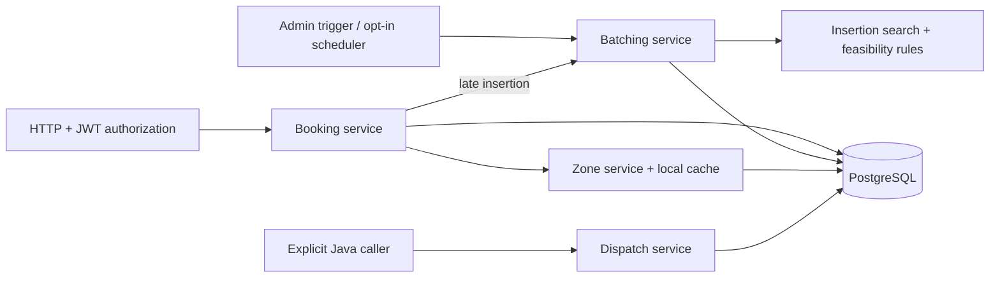

# SLA-Aware Ride Batching

A Java Spring Boot backend that combines employee ride requests into shared trips while enforcing modelled pickup deadlines, seat capacity and rider detour limits.

Jump to the [algorithm](#batching-algorithm), [tests](#how-to-run-tests) or [quick demo](#quick-demo).

## Problem

Ad-hoc employee pickups can produce unnecessary cab journeys. Nearby pickups and similar destinations suggest sharing, but a shared route may delay an urgent rider, exceed seats or introduce an unacceptable detour. This repository implements the core On-Demand Ride Batching case study.

## The important insight

**Batching is an optimization; SLA, capacity and correctness are hard constraints.** The planner checks every rider before accepting a route. If sharing fails, it evaluates a solo trip; if that also fails, the booking stays pending.

## What the system supports

| Area | Implemented scope |
| --- | --- |
| Bookings | Authenticated creation, pickup-zone validation, logical deduplication, retrieval, pagination and cancellation |
| Planning | Manual batching; opt-in scheduled cycles; greedy insertion with structure, capacity, pickup SLA and detour checks |
| Trip mutation | Late insertion into planned trips; cancellation removes and resequences only the affected route |
| Dispatch | Java services for eligible-driver ranking, offers, rejection cool-off and atomic acceptance; no driver HTTP API |
| Operations | PostgreSQL persistence, Flyway migrations, JWT ownership/role checks, zone caching, health, metrics and Prometheus |

The [requirements matrix](docs/requirements-traceability.md) links these claims to implementation, tests and demo evidence.

## Architecture

One Spring Boot process owns HTTP, planning and persistence. Feature packages share transactions and repositories.



Batching does not automatically call dispatch. Key code: [BatchPlanner](src/main/java/com/ridebatching/batching/BatchPlanner.java), [TripFeasibilityEvaluator](src/main/java/com/ridebatching/batching/evaluator/TripFeasibilityEvaluator.java), [BookingService](src/main/java/com/ridebatching/booking/BookingService.java), [DispatchService](src/main/java/com/ridebatching/dispatch/DispatchService.java).

## Batching algorithm

1. Claim pending bookings with PostgreSQL `FOR UPDATE SKIP LOCKED`.
2. Sort by pickup deadline, then booking ID.
3. Enumerate pickup/dropoff insertion positions while preserving each existing trip's stop order.
4. Evaluate the cheapest insertion per trip: route structure, peak occupancy, every pickup deadline and every rider's detour.
5. Choose the feasible trip with the smallest added estimated duration; otherwise check a solo route or leave the request pending.
6. Persist routes and confirmed booking associations in one transaction.

Only the cheapest insertion per trip is checked: a more expensive feasible alternative may be missed. This is not a global optimum. Random trip UUIDs also affect equal-cost ties across fresh runs. See [strategy](docs/batching-strategy.md) and [complexity](docs/algorithm-analysis.md).

## Correctness and concurrency

- **Duplicates:** a partial unique index protects active keys. `INSERT … ON CONFLICT DO NOTHING` preserves a usable creation transaction; a duplicate returns the existing booking.
- **Competing batch workers:** locked rows are skipped; trip persistence and booking confirmation commit or roll back together.
- **Route mutations:** creation/insertion are atomic. Insertion and cancellation lock booking before trip; insertion reloads and rechecks current riders/state.
- **Driver assignment:** acceptance locks trip, offer and driver, then rechecks eligibility and actual seat capacity. Offer responses are serialized; driver versions reject stale detached updates.
- **Stored invariants:** foreign keys and deferred stop uniqueness protect committed state. Empty-trip cancellation releases its driver and expires outstanding offers.

PostgreSQL tests force these races and check committed outcomes. They cover concrete interleavings, not every possible execution. See [test evidence](docs/test-matrix.md) and [failure boundaries](docs/failure-modes.md).

## Technology choices

| Choice | Reason |
| --- | --- |
| Java 17 / Spring Boot 3 | Explicit domain types and inspectable HTTP, authorization and transaction wiring; CI uses Java 21 |
| PostgreSQL 16 / Flyway / JPA | Constraints and row locks arbitrate races; migrations own the schema and Hibernate validates it |
| JUnit / Testcontainers | Algorithm tests plus real PostgreSQL integration tests, including migrations and rollback; no H2 substitution |
| JWT / BCrypt | Stateless request authentication, encoded account passwords and current-account ownership/role checks |
| Caffeine | Cache active-zone lookups locally; repository writes evict after commit, while external writers remain a staleness limitation |
| Micrometer / Actuator / springdoc | Inspect health, event counters, candidate rejection counts and generated HTTP contracts |

## How to run

Requires JDK 17+ and a running Docker daemon. The reviewer demo also requires Docker Compose and Python 3.9+. Maven is supplied by the wrapper; first use downloads dependencies and container images.

```sh
git clone https://github.com/aakash-kr-7/sla-aware-ride-batching.git
cd sla-aware-ride-batching
```

The quick demo below needs no environment editing. [Ordinary local setup](docs/demo.md#local-http-walkthrough) requires supplied DB/JWT values and explicit accounts/zones. Normal app port: 8080; isolated demo: 18080.

## How to run tests

```sh
./mvnw clean verify
```

On PowerShell use `./mvnw.cmd clean verify`. This runs the full suite and packages the executable JAR under `target/`. Integration tests use disposable PostgreSQL Testcontainers databases, independent of Compose/`.env`. `./mvnw test` runs tests alone. CI runs the same clean build, then the separately enabled demo test.

## Quick demo

```sh
python scripts/demo/demo.py reset
python scripts/demo/demo.py run --hold
```

Use `python3` if required. macOS/Linux equivalents: `./scripts/demo/reset.sh` and `./scripts/demo/run.sh --hold`. The runner starts PostgreSQL on **55432** and the actual HTTP application on **127.0.0.1:18080**, then asserts:

duplicate identity/count → zone rejection → four-plus-one split → SLA split → eligible offer → rejection/cool-off → backup acceptance → late insertion → isolated cancellation → metrics.

The test-only runner uses real HTTP plus existing Java services for driver offers/trip inspection; it is absent from the application JAR. [Walkthrough](docs/demo-walkthrough.md): 6–10 minutes, commands and observed evidence under `target/demo/`. Open [demo Swagger](http://localhost:18080/swagger-ui/index.html) while held.

Stop with `Ctrl+C` or `python scripts/demo/demo.py stop`. Reset deletes only the disposable demo project's volume. `clean verify` removes demo evidence; regenerate it afterward.

## Documentation map

| Read | Purpose |
| --- | --- |
| [Project explained](docs/project-explained.md) | Plain-language design, file map, Swagger controls and how each case-study scenario arises |
| [Requirements traceability](docs/requirements-traceability.md), [test matrix](docs/test-matrix.md) | Implementation claims, assertions and coverage gaps |
| [Architecture](docs/architecture.md), [domain model](docs/domain-model.md) | Responsibilities, request flow and reachable states |
| [Batching strategy](docs/batching-strategy.md), [algorithm analysis](docs/algorithm-analysis.md) | Search, feasibility and computational cost |
| [API contract](docs/api-design.md), [demo walkthrough](docs/demo-walkthrough.md) | Actual endpoints and reproducible behaviour |
| [Assumptions](docs/assumptions.md), [failure modes](docs/failure-modes.md) | Policy choices, approximations and operational limits |
| [Correctness review](docs/correctness-review.md), [decisions](docs/decisions/0005-handle-booking-deduplication.md), [contribution conventions](CONTRIBUTING.md) | Historical findings, design rationale and working standards |

Source lives in `src/main`, tests in `src/test`, demo commands in `scripts/demo`, and optional JMH source in `src/benchmark`. [Benchmark notes](docs/benchmarks/batching.md) are dated synthetic measurements, not current service-performance claims.

## Known limitations

- Runtime batching claims all pending rows. Window and zone/direction clustering components exist but are not integrated; claim and candidate scans are unbounded.
- ETA uses straight-line distance, fixed speed/circuity and dwell; driver approach and live road/traffic data are absent. Computed SLA acceptance does not guarantee actual pickup time.
- No automatic dispatch/re-offer/escalation, driver notification transport, trip execution API or escalation resolution workflow. Late insertion supports planned trips only.
- Cancellation removes/resequences stops without a new optimization or execution-time feasibility check. Zone caching has no cross-instance/direct-SQL invalidation.
- Actuator metrics are public under the assessment policy. No backup/restore validation, load guarantee or deployment stack is supplied. Existing invalid legacy data must be repaired explicitly before migration V11.

## Future production evolution

Complete bounded window/clustering and execution/dispatch workflows, calibrate road ETA/cancellation semantics, then measure load and validate operational access, cache freshness and recovery. These remain future work.
