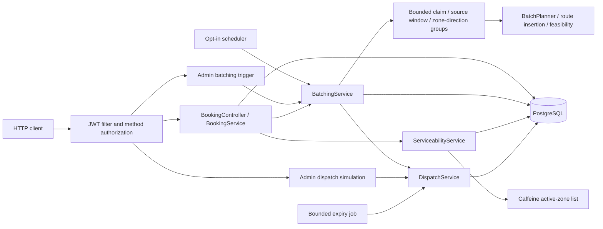
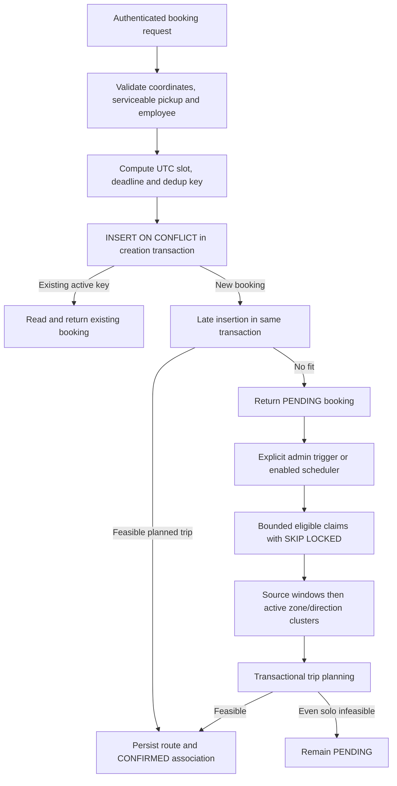

# Architecture and Request Flow

One Spring Boot process serves HTTP requests and runs planning against PostgreSQL. Feature packages organize code, but services share repositories and entities; they are not independently enforced modules. There is no message broker or external routing service.



Batching attempts an initial driver offer for each new trip in the same transaction. Authenticated admin simulation endpoints expose inspection, rejection, acceptance and bounded advancement. A scheduled job advances due offers; no driver notification transport is supplied. Escalations have a read API, with no automatic producer or resolution workflow.

## Code boundaries

| Package | Responsibility / entry point |
| --- | --- |
| `booking` | [BookingService](../src/main/java/com/ridebatching/booking/BookingService.java): ingest, deduplicate, retrieve, cancel |
| `batching` | [BatchingService](../src/main/java/com/ridebatching/batching/BatchingService.java): transactional orchestration; planner, constraints and evaluator are separate algorithm components |
| `trip` | [Trip](../src/main/java/com/ridebatching/trip/Trip.java): ordered-stop aggregate; [RouteInsertionPlanner](../src/main/java/com/ridebatching/trip/RouteInsertionPlanner.java): insertion search |
| `driver`, `dispatch` | Driver state, selection, offers and assignment |
| `zone`, `geo`, `fleet` | Circular serviceability, distance/ETA estimates and non-persisted planning capacity |
| `auth`, `escalation` | Account authentication/authorization and exception-record inspection |
| `api`, `config`, `dev` | Shared HTTP concerns, framework wiring and opt-in local admin bootstrap |

HTTP DTOs normally live beside their feature. Controllers translate requests; services coordinate persistence; domain types guard local state. The escalation read API currently returns entities directly. Algorithm components can be tested without HTTP or a database.

## Booking to trip



The HTTP route returns 201 for both a new booking and a duplicate. There is no client-requested time field: creation time supplies the slot and pickup promise. Creation and late insertion commit together; an insertion exception rolls back the new booking. See [concurrency and failure boundaries](failure-modes.md).

## Driver offers

```mermaid
sequenceDiagram
    participant B as Batching / admin simulation / expiry job
    participant S as DispatchService
    participant DB as PostgreSQL
    B->>S: advanceTrip(tripId)
    S->>DB: Lock trip; inspect offer history
    S->>S: Exclude attempted/ineligible drivers; rank nearest
    S->>DB: Persist initial OFFERED (or no offer)
    S-->>B: Route, activeOfferId, history and outcome
    alt Admin simulates rejection
        B->>S: rejectOffer(activeOfferId)
        S->>DB: Lock trip and offer; set REJECTED
        S->>DB: Persist next untried driver's offer
    else Offer deadline reached
        B->>S: advanceTrip(tripId)
        S->>DB: Set EXPIRED; try next driver within attempt limit
    else Admin simulates acceptance
        B->>S: acceptOffer(activeOfferId)
        S->>DB: Lock trip, offer and driver; recheck expiry/capacity/eligibility
        S->>DB: Commit accepted offer and matching trip/driver assignment
    end
```

Driver status remains `AVAILABLE` after assignment; `activeTripId` excludes it from selection. Offers are provisional and do not reserve a driver. The stored first pickup supplies proximity ranking; HTTP accepts no driver identity or pickup coordinates. Default lifetime is two minutes, with at most three distinct driver attempts per trip. A rejected driver enters the existing same-trip five-minute cool-off; the workflow's no-repeat rule also excludes every attempted driver for that trip permanently. See [offer outcomes and recovery](dispatch-workflow.md).

## Why these choices

- **Spring Boot monolith, feature packages:** one process keeps booking/trip transaction boundaries inspectable. It shares CPU, memory and DB connections between HTTP and planning; no load guarantee follows from that choice.
- **PostgreSQL + Flyway + JPA:** database indexes and row locks arbitrate races; migrations own schema, Hibernate validates it. This avoids correctness depending on a process-local lock or cache. Tests use actual PostgreSQL 16 via Testcontainers, not H2.
- **Greedy insertion + separate constraints:** small components expose why a route is accepted or rejected. Local cost choices are inspectable, but do not find a global optimum or every feasible insertion. See [planning strategy](batching-strategy.md).
- **Caffeine for zones only:** zone reads are frequent and the data changes less often than trip state. Freshness is TTL-bounded; mutable booking/assignment guarantees stay in PostgreSQL. See [cache decision](decisions/007-zone-caching.md).
- **Explicit transaction boundaries:** duplicates need a usable transaction after a losing insert; see [dedup decision](decisions/0005-handle-booking-deduplication.md). Batching, cancellation and acceptance each coordinate their own changes.

Java 17 is the build target; CI runs Java 21. No distributed infrastructure is needed for this submission. Production routing, driver identity/notification delivery and wider race coverage would be further work, not properties of the current architecture.
