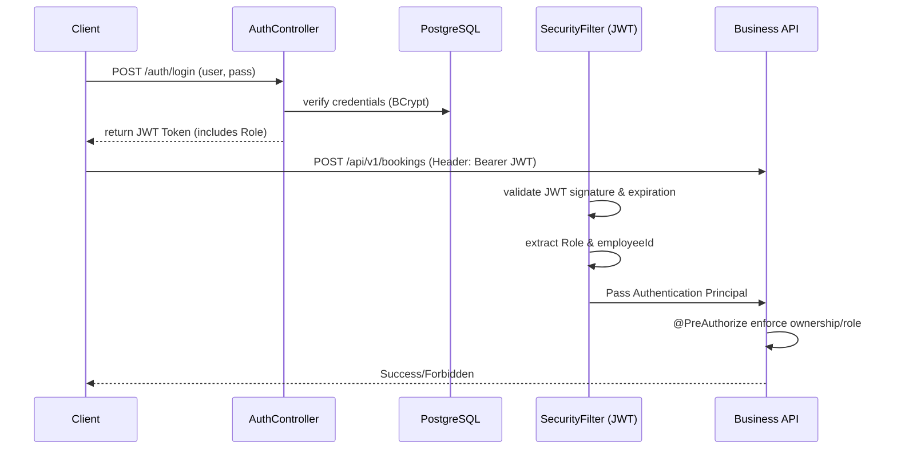

# Authorization Boundaries

This document defines the security and authorization conventions for this project, clarifying identity models, roles, and ownership rules.

## Identity and Domain Separation

We maintain a strict separation between Authentication Identity (`UserAccount`) and Transport-Domain Entity (`Employee`).

*   **`UserAccount`**: Handles credentials (BCrypt password hash), roles (Spring Security), and JWT issuance. This is purely for authentication and authorization.
*   **`Employee`**: Represents the physical person, their service location, schedule, and trip assignments within the transport domain. 

Mixing these two violates the Single Responsibility Principle and couples security concerns with business logic.

## Authentication Flow

## Role & Endpoint Matrix

| Endpoint                          | EMPLOYEE | APPROVER | ADMIN | Ownership Rules |
| :---                              | :---:    | :---:    | :---: | :---            |
| `POST /auth/login`                | ✅        | ✅        | ✅     | None            |
| `POST /api/v1/bookings`           | ✅        | ❌        | ✅     | `employeeId` in request must match authenticated `employeeId` (unless ADMIN). |
| `GET /api/v1/bookings`            | ✅        | ❌        | ✅     | `employeeId` in request must match authenticated `employeeId` (unless ADMIN). |
| `GET /api/v1/bookings/{id}`       | ✅        | ❌        | ✅     | `returnObject.employeeId` must match authenticated `employeeId` (unless ADMIN). |
| `DELETE /api/v1/bookings/{id}`    | ✅        | ❌        | ✅     | `employeeId` in request must match authenticated `employeeId` (unless ADMIN). |
| `POST /api/admin/batching/trigger`| ❌        | ❌        | ✅     | ADMIN only. |
| `GET /api/v1/escalations/open`    | ❌        | ✅        | ✅     | Allows APPROVER to inspect unsafe SLAs. |

## Ownership Rules
Employees cannot impersonate other employees. Even if an employee obtains the `employeeId` of another worker, the `@PreAuthorize` and `@PostAuthorize` annotations strictly enforce that the requested action matches the `employeeId` bound to their authenticated session (JWT).

## The Limited Purpose of APPROVER
The `APPROVER` role is intentionally limited and is not a broad administrative role. It exists purely to manage exception flows—specifically **SLA Escalations**. 
When a booking cannot be assigned and its SLA is becoming unsafe, an escalation is created. The `APPROVER` is tasked with reviewing and resolving these escalations without having access to operational triggers like manual batching, preventing abuse of administrative power.
