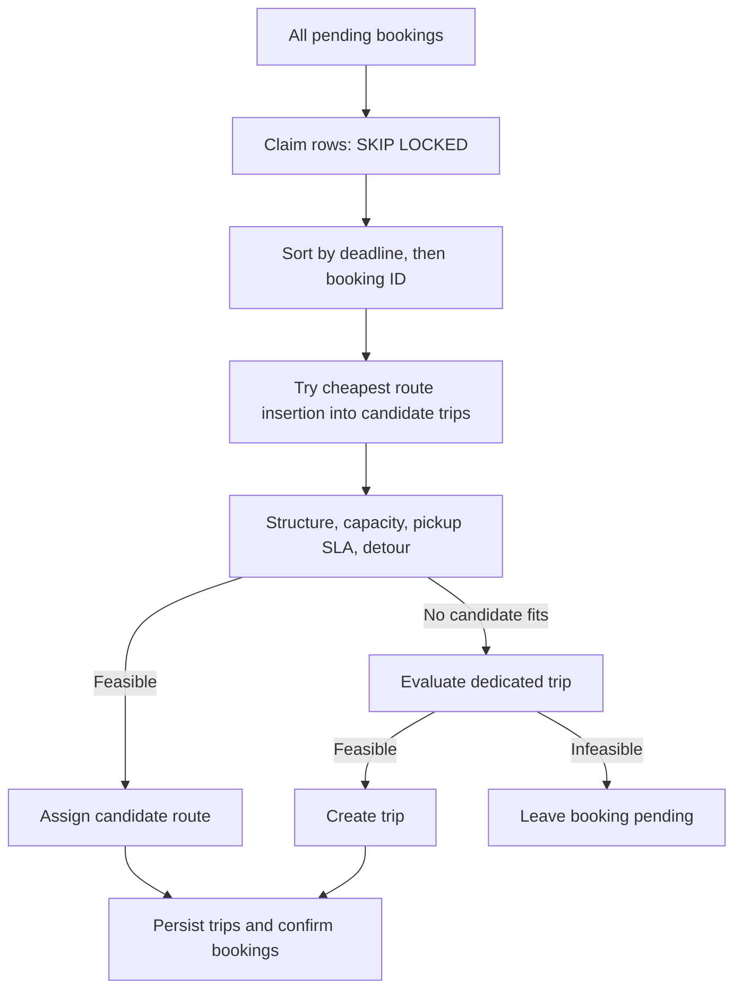

# Batching and Route Planning

`BatchingService.formBatches()` claims **all** pending bookings with `FOR UPDATE SKIP LOCKED`, plans/persists trip aggregates and confirms assigned bookings in one transaction. Exceptions roll back trips, stops and booking associations together.

`BatchPlanner` is a deterministic greedy heuristic. It compares feasible trips by incremental route cost. `RouteInsertionPlanner` enumerates pickup-before-dropoff positions and returns the lowest-cost route. **Only that route is feasibility-checked**; a more expensive feasible insertion may be missed.

`TripFeasibilityEvaluator` checks structural order, capacity, pickup deadlines and both detour bounds, emitting a rejection trace. ETA starts at first pickup and excludes driver approach. Dedicated trips are checked too: splitting cannot rescue an expired promise.

## Window and clustering boundary

`BatchingWindow` defines UTC buckets and eligible selection. Booking creation uses the bucket start for deduplication. `RequestClusterer` groups by zone and leader bearing, ordered by creation time/ID. Both have unit tests.

Neither is currently called by `formBatches()`. Slot duration is not a runtime collection delay; same-window/zone/direction orchestration is not enforced by that service.

The admin endpoint runs one cycle. Scheduling is disabled unless explicitly enabled; fixed delay defaults to five seconds. Batch formation does not dispatch drivers or produce escalations.

## Cost and bounds

For N bookings, T candidate trips and S stops, planning takes O(N log N + N*T*S^3). Insertion enumerates O(S^2) positions and calculates O(S) route cost for each. See [algorithm analysis](algorithm-analysis.md).

Capacity bounds peak occupancy, not total route stops: passenger turnover can exceed twice the seat count. No explicit pending-row/stop cap exists. Window length and physical seats alone do not prove bounded runtime work.

See [assumptions](assumptions.md), [trip mutations](trip-mutation-flows.md) and [tests](test-matrix.md).
