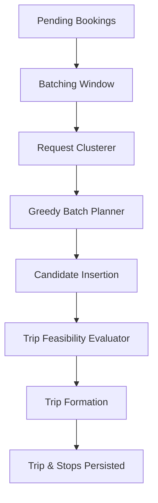
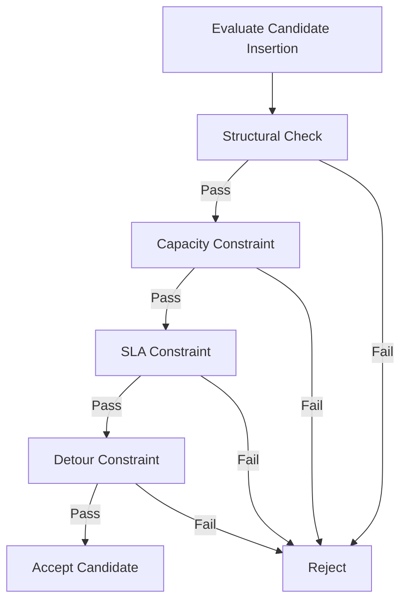

# Batching Design

This document details the batching algorithm and rules implemented in the application.

## 1. Request-to-Trip Flow

When a batching cycle is triggered, the system extracts eligible pending bookings and processes them into fully formed trips.



## 2. One Candidate Decision

When attempting to insert a booking into an existing candidate trip, the system evaluates structural and SLA-based constraints in a strict sequence to avoid expensive calculations when an earlier constraint fails.



## 3. High-Level Algorithm Complexity

The batching algorithm operates as a **deterministic greedy heuristic**.

Given:
- $N$: Number of bookings in a cluster.
- $M$: Number of existing active/planned trips.
- $S$: Maximum number of stops per trip.

**Algorithm Steps & Complexity:**
1. **Sorting**: Bookings are sorted by urgency (`pickupSlaDeadline` ascending), breaking ties by ID to ensure determinism. $O(N \log N)$
2. **Insertion Generation**: For each booking, we attempt insertion into existing trips.
    - An existing trip with $S$ stops has $O(S^2)$ possible valid insertion point pairs (pickup before drop-off).
    - We evaluate insertion for all $M$ active trips.
3. **Evaluation**: Each insertion point is evaluated against constraints (Capacity, SLA, Detour). $O(S)$ per insertion evaluation.
4. **Fallback**: If no existing trip is feasible, a new trip is formed containing just the current booking.

**Overall Complexity**: 
For $N$ bookings, the worst-case number of trips is $N$. If we form $N$ trips, the search space grows as we process bookings. In practice, vehicle capacity strictly limits $S$ (e.g., $S \le 8$ for a 4-seater). Thus $S$ is $O(1)$.
Therefore, for each of the $N$ bookings, we evaluate at most $O(N)$ candidate trips.
The worst-case time complexity per cluster is **$O(N^2)$**, making it highly efficient for reasonable cluster sizes.

### Transaction Boundaries and Concurrency
To allow concurrent workers without introducing distributed locks, batching relies on native PostgreSQL locking:
```sql
SELECT * FROM bookings WHERE status = 'PENDING' FOR UPDATE SKIP LOCKED
```
Workers exclusively claim non-overlapping sets of pending bookings and process them transactionally.
