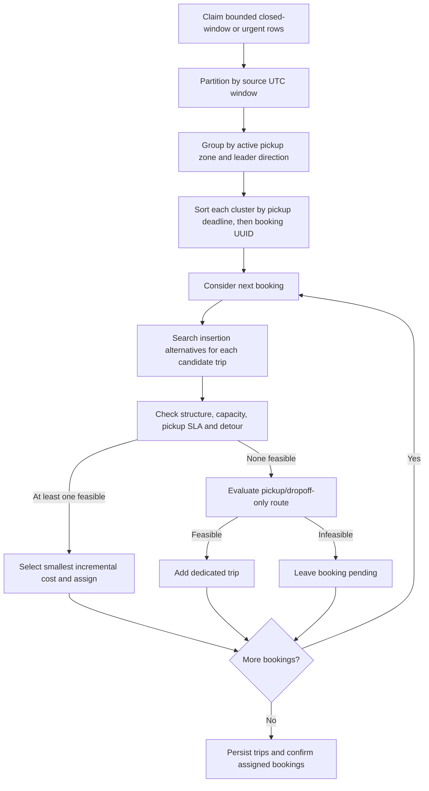
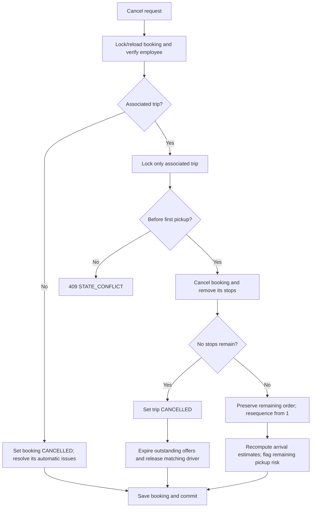

# From collection windows to feasible trips

The pipeline separates three decisions: **when** to claim a request, **which requests** to compare, and **whether their route** is feasible. A geographic match passes only the prefilter; capacity, pickup SLA and detour still decide whether sharing is allowed.

For a visual example, see the [four-plus-one workflow](reviewer-guide.md#2-four-plus-one-and-route-inspection--about-two-minutes). The rules below describe normal runtime; the [explicit local fixture profile](local-development.md#isolation-and-policy-differences) changes the urgency budget and offer lifetime for a short walkthrough.

## Runtime cycle

[BatchingService.formBatches](../src/main/java/com/ridebatching/batching/BatchingService.java) claims at most `app.batching.max-bookings-per-cycle` eligible rows (default 100, permitted range 1–1000) using PostgreSQL `FOR UPDATE SKIP LOCKED`. It partitions the claims by source collection window, then active pickup zone and compatible direction. Each cluster passes through the existing planner and all feasibility checks. Trip/stop persistence and booking confirmation share the claim transaction; failure rolls back the whole cycle.

### Collection and eligibility rules

The server's booking `createdAt` determines a fixed UTC epoch bucket, with inclusive start and exclusive end. The default duration is 15 minutes. A booking at 10:14:59 belongs to [10:00, 10:15); one at exactly 10:15 belongs to [10:15, 10:30). Grouping recomputes the bucket from creation time rather than trusting a legacy dedup slot. Keep the configured duration stable while requests are outstanding.

One UTC clock reading supplies eligibility and route-start estimates for the cycle:

| Condition | Outcome |
| --- | --- |
| PENDING, no trip, creation time <= cycle time, deadline >= cycle time, source window closed | Eligible |
| Same conditions, open source window, deadline <= cycle time + urgent lead time | Eligible early; default lead time is 300 seconds |
| Open window and deadline beyond the urgent cutoff | Continue collecting; even an admin trigger does not bypass this rule |
| Deadline < cycle time | Remain PENDING/unassociated for inspection; excluded from planning claims; a separate bounded pass persists one OPEN missed-solo-promise escalation, without extending the deadline |
| Deadline exactly equals cycle time | Eligible; the evaluator still checks feasibility, accepting an immediate first pickup at equality |
| Future creation time, CANCELLED or already associated | Not claimed |
| Pickup no longer resolves to an active zone | Claimed booking remains pending; logged and excluded from clusters, never grouped under an unknown-zone sentinel |

An urgent booking remains in its own source window. A backlog can contain several closed windows, but those windows never share newly formed trips. SQL orders eligible rows by deadline, creation time and UUID before applying the limit; windows are visited in first-claimed order, and the planner orders each cluster by deadline/UUID. Zone resolution uses the current cached active-zone view and retains its documented staleness limits.

Overflow stays eligible for subsequent cycles. Expired and not-yet-eligible requests do not consume the row limit. `bookingsConsidered` is the claimed count; `bookingsLeftPending` counts unassigned claims only, not the entire queue. Therefore all-zero counts can coexist with collecting or expired bookings.

The urgency guard avoids deliberately waiting for collection close when the pickup budget is short. It does not guarantee timely processing under overload, worker downtime or slow planning. Scheduler polling and the simplified ETA remain relevant. Multiple workers or limited claims can fragment a window/cluster into extra trips; this trades maximum pooling for bounded per-worker work and exclusive ownership. The limit bounds materialized planner input, not PostgreSQL scan cost or all application operations.

The greedy planner prefers sharing if any candidate fits. It chooses by added estimated route duration; equal costs choose the lower trip UUID. New trip UUIDs are random, so tie-breaking is stable for supplied identities, not a promise of identical grouping across fresh runs. There is no occupancy objective function or global trip-count optimum.

Scheduling is disabled by default. The admin trigger runs one cycle; an enabled scheduler uses fixed delay, independently of booking-slot duration. Both paths attempt an initial driver offer for each newly planned trip in the same transaction. Both also run a separately bounded expired-request escalation pass; [lifecycle policy](booking-lifecycle.md) defines uniqueness, remedies and count semantics. Dispatch rejection/expiry and bounded retries are described in the [offer workflow](dispatch-workflow.md).

## Insertion search and acceptance

[RouteInsertionPlanner](../src/main/java/com/ridebatching/trip/RouteInsertionPlanner.java) preserves the existing relative stop order. For S existing stops it enumerates `(S+1)(S+2)/2` pairs: pickup index 0..S, then dropoff index strictly after pickup. It constructs each candidate and sums estimated durations between adjacent stops. The lowest total cost wins; ties retain earliest pickup, then earliest dropoff positions.

The insertion component accepts a feasibility predicate without owning domain rules. [BatchPlanner](../src/main/java/com/ridebatching/batching/BatchPlanner.java) checks alternatives and retains the cheapest feasible route per trip, using [TripFeasibilityEvaluator](../src/main/java/com/ridebatching/batching/evaluator/TripFeasibilityEvaluator.java):

| Check | Acceptance rule |
| --- | --- |
| Structure | Pickup before dropoff, valid onboard progression, no repeated pickup/drop pairs and no missing dropoff; `Trip.assignRoute` validates the same route structure |
| Capacity | Peak concurrent passengers <= planning seats; one booking represents one rider |
| Pickup SLA | Estimated pickup <= stored deadline for every booking; equality is accepted |
| Detour | For each rider, extra in-vehicle time <= both absolute limit and relative limit times direct estimated duration |

Checks short-circuit at the first rejection and return a trace containing the constraint code and affected booking where applicable. All legal insertion positions are costed; once a feasible cost is known, equally or more expensive candidates cannot improve it and skip constraint evaluation. Candidates stream through O(S) temporary space. A dedicated route is evaluated too; an expired SLA stays pending rather than being assigned a knowingly infeasible trip.

Unassigned planning/insertion ETA starts at captured route-start time at the first pickup. Subsequent legs include travel and destination dwell. Offering and acceptance shift that start by current-time driver approach, without initial dwell; [ETA policy](planner-and-eta.md) defines the exact checks. Detour measures pickup-to-dropoff duration using the same estimator for the direct baseline. If direct duration is zero, any non-zero detour fails the relative check. Runtime limits and approximation choices belong in [assumptions](assumptions.md).

## Window and clustering implementation

`BatchingWindow` computes UTC epoch buckets, inclusive start/exclusive end. Creation uses the bucket start in the dedup key. `BatchClaimPolicy` uses the same bucket calculation for eligibility and source-window partitioning.

`RequestClusterer` groups each claimed source window by resolved pickup-zone ID, then creation time/UUID and leader bearing. The first member remains the leader; difference <= configured 45 degrees is compatible. Members can differ by up to twice that threshold, so direction is a prefilter, not a detour guarantee. Unknown zones are omitted. The leader criterion and trade-offs are in [clustering decision](decisions/0006-request-clustering.md).

[WindowedBatchingIntegrationTest](../src/test/java/com/ridebatching/batching/WindowedBatchingIntegrationTest.java) exercises the real service with a fixed cycle clock, two windows, two zones, opposing directions, urgency, expired/future requests, overflow and four-plus-one/SLA splits. [BatchClaimIntegrationTest](../src/test/java/com/ridebatching/batching/BatchClaimIntegrationTest.java) verifies SQL boundaries and ordering. [ConcurrentBatchingIntegrationTest](../src/test/java/com/ridebatching/batching/ConcurrentBatchingIntegrationTest.java) holds one worker in planning while another claims a disjoint bounded set and commits. Route cost and demand bounds are analyzed in [algorithm analysis](algorithm-analysis.md).

## Late arrival

Late insertion locks and reloads the booking first, accepting only an unassociated PENDING row. It searches PLANNED trips, then locks and reloads the selected aggregate, including stops, checks its current state and rebuilds the route-specific booking map before re-evaluating all riders. Creation joins this transaction. Dispatched trips are excluded. It does not retry another trip after the selected one fails revalidation. This separate late-add path may cross collection windows/directions when all route constraints pass; it does not use the new-trip collection gate or claim limit, and its candidate scan remains unbounded.

Booking mutations use booking-then-trip lock order. PostgreSQL regressions cover stale cancelled/assigned input, cancellation racing insertion and a competing route replacement that adds a rider with a tight SLA. See [failure boundaries](failure-modes.md).

## Local cancellation

This implements localized stop removal, not a fresh route optimization. Unrelated trips are untouched. Cancellation is state-idempotent, rejects executing/completed trips even for a CONFIRMED rider, retains the booking's trip ID, and expires outstanding offers/releases the matching driver when the trip becomes empty. Before execution, remaining estimates are recalculated, including current driver approach for accepted trips; actual/planning seats and detour are rechecked, and missed pickup promises are escalated. Execution-time cancellation is unsupported. See [timing assumptions and evidence](booking-lifecycle.md). Without road-metric assumptions, deleting a stop is not proof that every remaining ETA improves. [Tests](test-matrix.md) verify isolation, concurrent mutation and empty-trip cleanup; they do not establish complete execution-time replanning.
