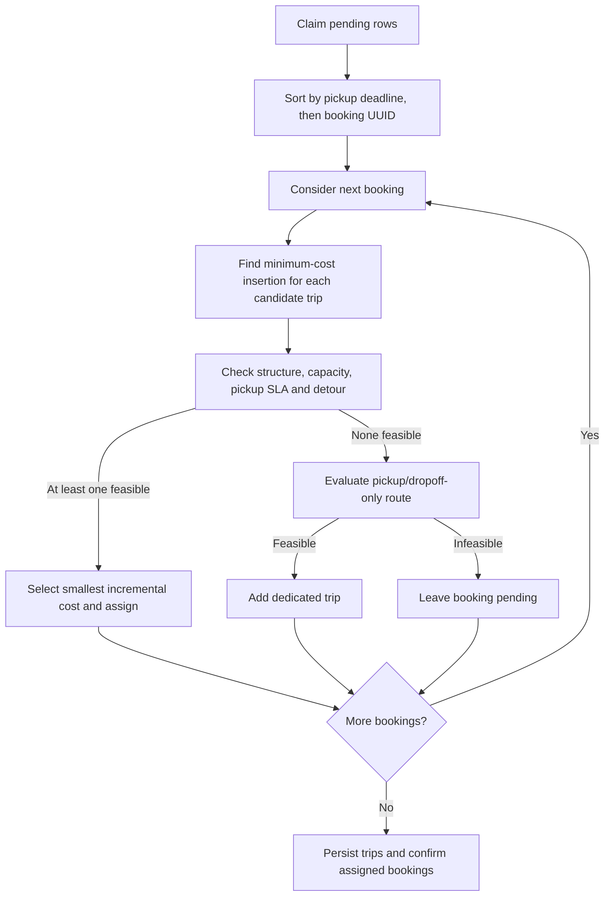
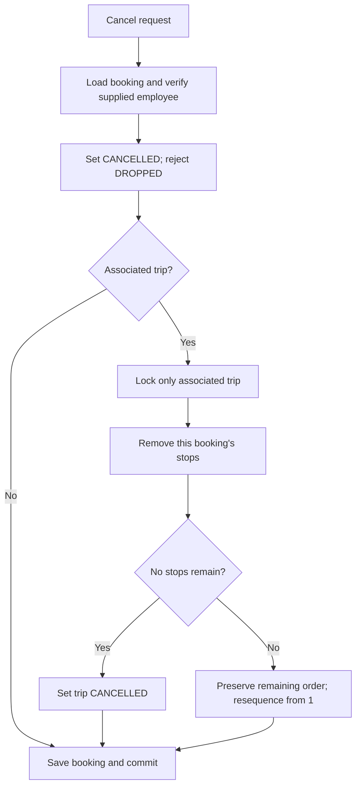

# Batching and Route Insertion

## Runtime cycle

[BatchingService.formBatches](../src/main/java/com/ridebatching/batching/BatchingService.java) claims all currently visible `PENDING` rows using `FOR UPDATE SKIP LOCKED`. It invokes the planner, persists trips/stops and confirms associated bookings in one transaction. The query has no slot, zone, direction or row-limit predicate. Rollback restores durable pending state.

The greedy planner prefers sharing if any candidate fits. It chooses by added estimated route duration; equal costs choose the lower trip UUID. New trip UUIDs are random, so tie-breaking is stable for supplied identities, not a promise of identical grouping across fresh runs. There is no occupancy objective function, maximum claim size or global trip-count optimum.

Scheduling is disabled by default. The admin trigger runs one cycle; an enabled scheduler uses fixed delay, independently of booking-slot duration. Neither path dispatches offers or creates escalations.

## Insertion search and acceptance

[RouteInsertionPlanner](../src/main/java/com/ridebatching/trip/RouteInsertionPlanner.java) preserves the existing relative stop order. For S existing stops it enumerates `(S+1)(S+2)/2` pairs: pickup index 0..S, then dropoff index strictly after pickup. It constructs each candidate and sums estimated durations between adjacent stops. The lowest total cost wins; ties retain earliest pickup, then earliest dropoff positions.

The insertion component does not know deadlines or capacity. [BatchPlanner](../src/main/java/com/ridebatching/batching/BatchPlanner.java) checks only the single cheapest route per trip, using [TripFeasibilityEvaluator](../src/main/java/com/ridebatching/batching/evaluator/TripFeasibilityEvaluator.java):

| Check | Acceptance rule |
| --- | --- |
| Structure | Pickup before dropoff, valid onboard progression and no missing dropoff; `Trip.assignRoute` also rejects repeated pickup/dropoff pairs |
| Capacity | Peak concurrent passengers <= planning seats; one booking represents one rider |
| Pickup SLA | Estimated pickup <= stored deadline for every booking; equality is accepted |
| Detour | For each rider, extra in-vehicle time <= both absolute limit and relative limit times direct estimated duration |

Checks short-circuit at the first rejection and return a trace containing the constraint code and affected booking where applicable. If the cheapest route fails, a more expensive feasible insertion is not searched. A dedicated route is evaluated too; an expired SLA stays pending rather than being assigned a knowingly infeasible trip.

Pickup ETA starts at route-start time at the first pickup. Subsequent legs include travel and destination dwell; driver approach and initial dwell are absent. Detour measures pickup-to-dropoff duration using the same estimator for the direct baseline. If direct duration is zero, any non-zero detour fails the relative check. Runtime limits and approximation choices belong in [assumptions](assumptions.md).

## Window and clustering components

`BatchingWindow` computes UTC epoch buckets, inclusive start/exclusive end. Creation uses the bucket start in the dedup key. Its pending/time selection method is tested but not called by batch formation.

`RequestClusterer` independently groups by resolved pickup-zone ID, then creation time/UUID and leader bearing. Unknown zones share a sentinel group; this is not a serviceability rejection. The leader criterion and trade-offs are in [clustering decision](decisions/0006-request-clustering.md).

Neither component partitions the runtime claim. The case study's window + zone/direction pipeline remains an integration gap. A time bucket alone would not cap the number of requests. Route cost and demand bounds are analyzed in [algorithm analysis](algorithm-analysis.md).

## Late arrival

After the new booking commits, late insertion loads `PLANNED` trips and a booking map, finds an initially feasible candidate, then locks only that trip. It checks status, refreshes the trip, repeats insertion/evaluation and persists the route/confirmation if feasible. Dispatched trips are excluded from the initial search. It does not retry another trip after the selected one fails revalidation.

The booking map is not rebuilt after refresh, and status is checked before that refresh. Mixed insertion/cancellation/dispatch races therefore need more coverage; the passing capacity race is not proof of every interleaving. See [failure boundaries](failure-modes.md).

## Local cancellation

This implements localized stop removal, not a fresh route optimization. Unrelated trips are untouched. Cancellation is state-idempotent, currently allows `PICKED_UP`, retains the booking's trip ID, and performs no feasibility recheck or offer/driver cleanup. Without road-metric assumptions, deleting a stop is not proof that every remaining ETA improves. [Tests](test-matrix.md) verify isolation, not complete execution-time replanning.
