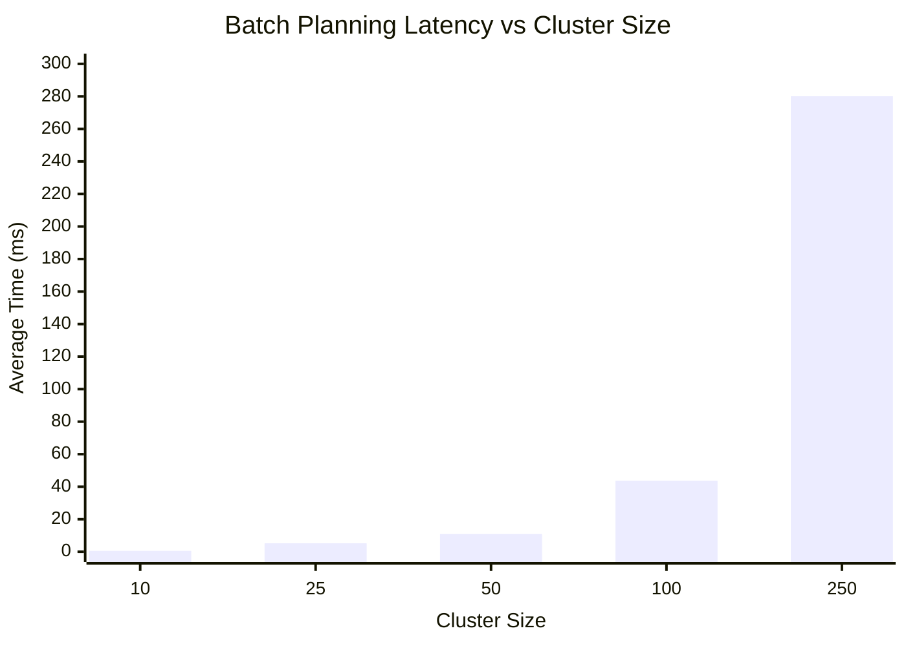

# Batching Algorithm Benchmark Results

Historical measurements recorded on 2026-10-10, before the repository hygiene pass and infeasible-solo fix. They have not been remeasured for the current revision. Do not treat them as current latency guarantees.

## Reproduce

JMH sources live in `src/benchmark/java`; the profile isolates its compiled/generated classes under `target/benchmark` so they do not leak into ordinary test discovery.

```sh
./mvnw -Pbenchmark -DskipTests verify
```

This compiles sources and runs the JMH harness, skipping ordinary JUnit execution for this benchmark-only command. Run normal correctness checks separately with `./mvnw test` and `./mvnw clean verify` (Windows: `./mvnw.cmd`). The harness uses 40% / 15-minute detour limits; runtime defaults are 100% / 30 minutes.

## Machine/JVM Context
- **JVM**: JDK 17.0.12 (Java HotSpot 64-Bit Server VM, 17.0.12+8-LTS-286)
- **OS**: Windows
- **Tooling**: JMH 1.37
- **Threads**: 1 thread (Synchronized iterations)
- **Warmup**: 2 iterations (1s each)
- **Measurement**: 3 iterations (1s each)
- **Blackhole Mode**: Compiler

## Benchmark Parameters
- `clusterSize`: The number of `Booking` entities generated for the single batching window scenario. Ranging from 10 to 250 requests.
- All requests use deterministic geographical locations mimicking a clustered urban environment with realistic SLA deadlines.

## Raw Summary Table

| Cluster Size | Average Time (ms/op) | Error Margin (ms) |
|--------------|----------------------|-------------------|
| 10           | 0.578               | ± 2.059          |
| 25           | 5.197               | ± 4.336          |
| 50           | 10.898              | ± 7.269          |
| 100          | 43.697              | ± 14.260         |
| 250          | 280.107             | ± 281.984        |

## Visualization



## Interpretation
The recorded averages increase with cluster size, consistent with the growing candidate search described in [algorithm analysis](../algorithm-analysis.md). Error margins are broad, especially for 250 requests. These synthetic, in-memory results do not establish an end-to-end latency budget, bounded route length or production capacity. They do not justify an architectural change during repository cleanup.

## Limitations
1. **CPU/Platform Variance**: Tested locally on a single machine. Cloud deployments may have different single-thread performance characteristics.
2. **Missing Network/DB Latency**: This benchmark isolates the pure algorithms. In reality, fetching hundreds of bookings via JPA and acquiring optimistic/pessimistic locks will likely dominate the actual wall-clock execution time.
3. **Distribution of Data**: Deterministic synthetic generation may produce artificially denser or sparser clustering compared to actual rush-hour distributions.
