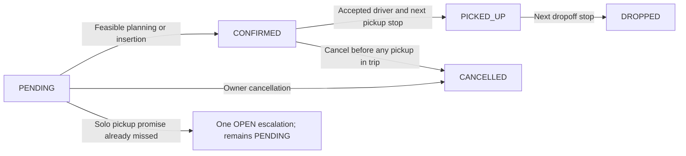

# Booking lifecycle and SLA recovery

`CONFIRMED` means a booking has a feasible planned route and persisted trip association. Driver acceptance is a separate event: it changes the trip from `PLANNED` to `DISPATCHED`. A confirmed booking can therefore still be waiting for a driver.

This distinction keeps request progress, route planning and actual assignment understandable. The [API reference](api-design.md) lists operations; the tests in [Evidence](#evidence) verify pre-execution cancellation and isolation through HTTP.



## Allowed transitions

| Operation | Preconditions | Committed result |
| --- | --- | --- |
| Plan / late insert | PENDING, feasible route | CONFIRMED with trip ID; driver need not have accepted |
| Accept offer | Unexpired stored offer, eligible driver and sufficient seats | Trip DISPATCHED; booking stays CONFIRMED |
| Pickup | CONFIRMED; accepted, active driver; this is the next unfinished route stop | PICKED_UP; first pickup starts trip IN_PROGRESS |
| Dropoff | PICKED_UP; this is the next unfinished route stop | DROPPED; last dropoff completes trip and clears driver's active-trip link |
| Cancel pending | Owning employee identity | CANCELLED; associated automatic SLA issues resolve |
| Cancel confirmed | Entire trip still PLANNED or DISPATCHED | CANCELLED; only that trip's route changes |
| Repeat cancellation | Already CANCELLED, same owner | Return current booking without another replan or metric increment |

Skipping a state, repeating pickup/dropoff, executing before acceptance, violating route order, or executing a cancelled/completed trip returns `409 STATE_CONFLICT`. Unknown bookings return `404 BOOKING_NOT_FOUND`. Terminal bookings cannot be revived. The booking retains its historical trip ID after cancellation. Completed routes and accepted offers are retained as history.

Execution facts are explicitly **admin simulations**. There is no driver login or arbitrary driver/status request field. The service verifies the driver already assigned to the trip and its active-trip reference. These operations report progression; they do not measure actual road arrival or prove that an SLA was met in reality.

## Reachable HTTP operations

Use an ADMIN token obtained through `/auth/login`; no request body or employee header is needed for execution:

```sh
curl -X POST "$BASE/api/admin/bookings/$BOOKING_ID/pickup" \
  -H "Authorization: Bearer $ADMIN_TOKEN"
curl -X POST "$BASE/api/admin/bookings/$BOOKING_ID/dropoff" \
  -H "Authorization: Bearer $ADMIN_TOKEN"
```

First inspect `GET /api/admin/dispatch/trips/{tripId}`. Accept its live `activeOfferId` through the [dispatch workflow](dispatch-workflow.md), then execute the ordered `stops` one at a time using their `bookingId` and `type`. In Swagger, these buttons are under **Admin (Execution simulation)**. Inspect booking status after each call; the trip view reports `IN_PROGRESS` and finally `COMPLETED`.

Cancellation remains `DELETE /api/v1/bookings/{id}` with the owning `X-Employee-Id`. Once **any rider** has been picked up, cancellation is unsupported for every rider in that trip, including riders still CONFIRMED. This avoids changing a route already being executed.

## Cancellation timing and isolation

Before execution, remove both cancelled stops, preserve the remaining stop order, resequence from one, and recompute every remaining stop's persisted `estimatedArrivalAt`. Recalculation starts at the later of the current batching clock and the trip's original planning start. For an accepted trip, reload/lock its driver and add its approach to the new first pickup; an unassigned trip stays optimistic at that start. Later arrivals add the existing estimator's travel/dwell duration. Capacity and detour are rechecked; violations return 409 ROUTE_INFEASIBLE and roll back cancellation. See [assignment timing](planner-and-eta.md).

The remaining pickups are checked against their own stored deadlines. A late estimate creates one OPEN booking issue with reason `Replanned pickup estimate exceeds the booking deadline`; a subsequent feasible recalculation resolves that issue. Cancelling the affected booking also resolves its automatic issues. Risk records remain inspectable until one of those remedies; simulated pickup/dropoff is not an escalation-resolution action. There is no automatic reassignment or deadline extension.

An empty trip becomes CANCELLED, expires outstanding offers and releases its assigned driver atomically. Other trips, their timestamps, routes and arrival estimates are untouched. Stop removal is a local replan, not a new route optimization or a proof that every remaining ETA improves under an arbitrary distance model.

## A pickup promise impossible even alone

Under unassigned planning, solo pickup occurs at the captured cycle time without a driver approach leg. Offering/new acceptance separately recheck approach and current time. Thus `pickupSlaDeadline < cycleTime` is already impossible even alone; equality still passes. Every batch cycle separately claims at most `app.batching.max-bookings-per-cycle` such expired, unassociated PENDING bookings that have no matching OPEN issue, using `FOR UPDATE SKIP LOCKED`.

It persists reason `Pickup deadline cannot be met even by a solo trip` and leaves the booking PENDING without a trip. A separate bounded pass protects the normal eligible-request budget from an expired backlog. The existing batch response counts **eligible planning claims only**, so zero considered can still mean escalation work occurred. Inspect `/api/v1/escalations/open` as ADMIN or APPROVER.

PostgreSQL migration V14 enforces one OPEN issue per `(reference_type, reference_id, reason)`; concurrent insertions use `ON CONFLICT DO NOTHING`. Repeated cycles retain the same issue ID and timestamps. Resolved records remain as history. If an issue is resolved without remedying the pending booking, a later cycle can create one new OPEN issue; there is no resolution HTTP endpoint. Cancellation closes the automatic booking issues and prevents reconsideration. Native issue writes share the surrounding transaction.

The policy covers missed solo pickup promises and cancellation-induced timing risk. Missing zones, exhausted offers and other failure reasons do not automatically become SLA issues. Planning checks do not establish actual service under overload, downtime or offer waiting.

V15 adds nullable arrival estimates for existing stop rows. New plans, insertions and cancellation replans populate them; old routes are not given invented historical estimates. V14 will reject inconsistent legacy duplicate OPEN issues rather than silently erase history.

## Evidence

Run with Java 17+ and Docker; PowerShell uses `./mvnw.cmd`:

```sh
./mvnw -Dtest=BookingTransitionTest,BookingLifecycleHttpIntegrationTest,BookingSlaEscalationIntegrationTest,BookingCancellationIntegrationTest test
```

- [Transition tests](../src/test/java/com/ridebatching/booking/BookingTransitionTest.java): allowed states and forbidden skips/repeats.
- [HTTP lifecycle tests](../src/test/java/com/ridebatching/booking/api/BookingLifecycleHttpIntegrationTest.java): real login, creation, batching, acceptance, ordered execution, completion/release, authorization, terminal rejection, cancellation ETA isolation and unresolved-risk identity. The concurrent test holds a real trip lock until both pickup and another rider's cancellation are waiting, then checks a coherent committed outcome.
- [SLA escalation tests](../src/test/java/com/ridebatching/batching/BookingSlaEscalationIntegrationTest.java): repeated cycles, bounded recovery without starving valid requests, exact deadline equality, concurrent PostgreSQL uniqueness and resolved history.
- [Cancellation regression](../src/test/java/com/ridebatching/booking/BookingCancellationIntegrationTest.java): compares committed affected/unrelated trip views.

Implementation: [Booking](../src/main/java/com/ridebatching/booking/Booking.java), [BookingExecutionService](../src/main/java/com/ridebatching/booking/BookingExecutionService.java), [BookingService](../src/main/java/com/ridebatching/booking/BookingService.java), [TripRouteTiming](../src/main/java/com/ridebatching/trip/TripRouteTiming.java), [BatchingService](../src/main/java/com/ridebatching/batching/BatchingService.java) and [BookingSlaEscalations](../src/main/java/com/ridebatching/escalation/BookingSlaEscalations.java).
