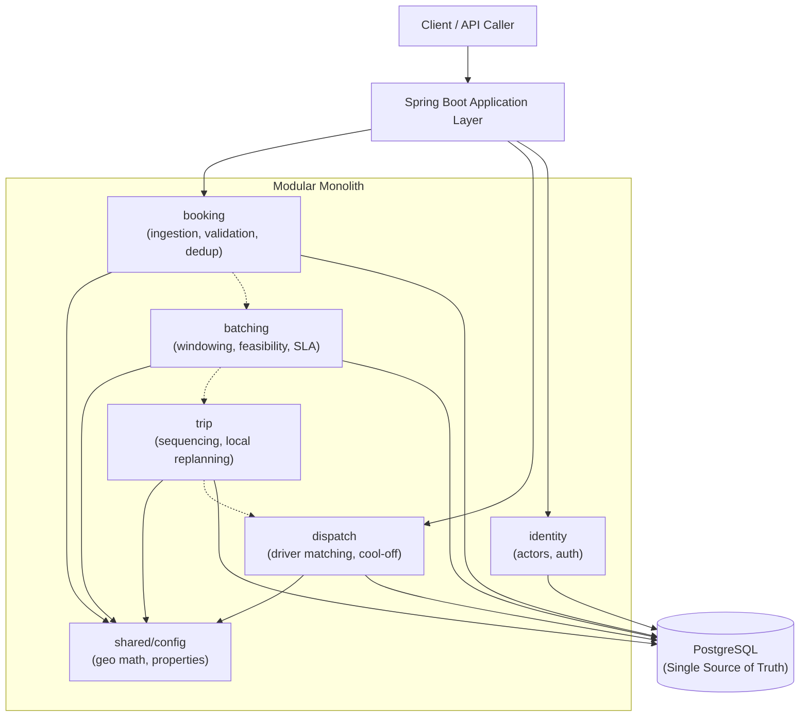

# ADR 001: Initial Architecture — Modular Monolith

## Status
Accepted

## Context
This project implements an orchestration backend for on-demand, SLA-aware employee ride batching. The primary challenge is not CRUD API mechanics, but evaluating combinatorial trip candidates under hard business constraints: pickup SLAs, vehicle capacities, detour boundaries, duplicate request protection, and driver cool-off rules.

Before writing code, we must commit to an architectural topology and technical baseline that balances transactional correctness, operational simplicity, and delivery speed.

## Decision
We choose a **modular monolith** architecture built with:
- **Language**: Java 21
- **Framework**: Spring Boot 3
- **Build tool**: Maven (with wrapper)
- **Primary database**: PostgreSQL
- **Schema management**: Flyway
- **Testing**: JUnit 5, AssertJ, Testcontainers (PostgreSQL)

### Feature Module Structure
The codebase will be partitioned into explicit top-level feature packages rather than horizontal technical layers. Each feature package owns its domain logic and internal components (`controller`, `service`, `repository`, `domain` / `model`):

1. **`booking`**: Handles ride request ingestion, serviceable-zone verification, deduplication enforcement, and booking lifecycle states (`PENDING`, `CONFIRMED`, `CANCELLED`, `PICKED_UP`, `DROPPED`).
2. **`batching`**: Collects pending requests within discrete time windows, applies bearing direction pre-filtering, and evaluates candidate trips against vehicle capacity, rider detour limits, and pickup SLAs.
3. **`trip`**: Manages confirmed shared trips, stop order sequencing, trip mutations, and localized replanning when cancellations occur.
4. **`dispatch`**: Evaluates driver eligibility (filtering active breaks and cool-off periods), ranks available drivers by proximity, generates offers, and tracks rejection history.
5. **`identity`**: Models system actors (Employee, Driver, Admin) and authentication/authorization boundaries.
6. **`shared/config`**: Houses cross-cutting geometry calculations (Haversine distance, circuity estimation, bearing math) and strongly-typed configuration properties (`@ConfigurationProperties`).

Cross-module interaction occurs via explicit service calls within the same process. Modules do not bypass service contracts or directly manipulate each other's persistence entities.

## Rationale: Modular Monolith vs Microservices
Splitting into distributed microservices at this stage would introduce significant operational and transactional complexity without solving any domain problem:

1. **Single transactional boundary**: Forming a shared trip requires checking pending bookings, allocating vehicle seats, and evaluating driver availability atomically. In a microservice architecture, enforcing hard constraints like strict vehicle capacity or single-booking deduplication would require distributed transaction protocols (2PC or Saga patterns), increasing failure modes and risking invariant violations.
2. **Latency and algorithmic compute**: Batching involves combinatorial evaluation of stop sequences against SLA thresholds. Executing these calculations in-memory within a single JVM process is orders of magnitude faster than serializing candidate states across network RPC boundaries.
3. **Zero infrastructure friction**: A modular monolith runs from a single command, requires no container orchestrator (Kubernetes) or service mesh, and tests cleanly in CI.
4. **Clean boundary preservation**: Should specific features require independent scaling in the future, well-isolated module boundaries make later extraction straightforward.

## Infrastructure Choices & Deferrals

### PostgreSQL as the Single Source of Truth
Every critical invariant—duplicate prevention via composite unique constraints, seat capacity validation, and isolated trip replanning—relies on ACID transactions and relational integrity. PostgreSQL serves as the definitive source of truth for all operational state.

### Business Correctness Must Not Depend on Caches
In-memory caching layers (application-level maps or distributed stores) introduce consistency lag, cache invalidation bugs, and race conditions under concurrent requests. Deduplication checks, seat availability, and driver offer assignments must query transactional database state directly.

### Kafka is Deliberately Deferred
Ride batching in this system operates on discrete 15-minute collection windows—a scheduled, batched workload rather than a high-throughput event stream. Introducing Kafka would add broker clustering, topic partitioning, poison-pill consumer handling, and out-of-order delivery concerns without solving the core constraint evaluation problem. Spring's built-in task scheduling and internal domain calls handle this cleanly.

### Redis is Deliberately Deferred
Redis is often introduced prematurely for caching or distributed locks. PostgreSQL advisory locks and standard relational locking (`SELECT FOR UPDATE`, row-level locks, unique constraints) satisfy all concurrency control and deduplication requirements in this system without adding a second datastore.

### Flyway for Schema Evolution
Database schemas must be version-controlled, reproducible, and tracked alongside application code. Flyway ensures database migrations apply deterministically across local development, CI test pipelines, and production environments.

### Testcontainers for Integration Testing
H2 and other in-memory databases do not replicate PostgreSQL locking semantics, transactional isolation levels, or native constraint behavior. Testcontainers ensures integration tests execute against real PostgreSQL instances, validating that database constraints behave correctly under test.

## Component Architecture

## Consequences
- **Positive**: Strong transactional consistency, straightforward local execution, fast unit/integration testing, and no distributed systems overhead.
- **Negative**: All feature modules share CPU, memory, and database connections within the same application process. Heavy combinatorial batching runs must be managed using bounded thread pools to prevent starving incoming HTTP booking requests.
