# One reproducible backend demo

This is a 6–10 minute explanation of one asserted scenario. The runner starts the real Spring Boot HTTP server against PostgreSQL 16, calls its exposed APIs over HTTP, and uses the existing Java services for dispatch. It adds no production endpoints or business features. Fixtures and the runner live under `src/test`; they are absent from the packaged application.

## Start from a clone

Prerequisites: JDK 17+ (including `javac`), Docker with Compose and a running daemon, and Python 3.9+. Maven comes from the wrapper. First use needs network access for dependencies and the PostgreSQL image. Run from the repository root.

On Windows / PowerShell:

```powershell
python scripts/demo/demo.py reset
python scripts/demo/demo.py run --hold
```

On macOS / Linux:

```sh
./scripts/demo/reset.sh
./scripts/demo/run.sh --hold
```

The same Python commands work across platforms; substitute `python3` if that is your executable name. No `.env` editing, database console, token copying, external map service, or manual seed steps are needed. The runner prints each verified stage and `PASS`; with `--hold`, leave that terminal open and use a second terminal for the commands below. Swagger is at [localhost:18080/swagger-ui/index.html](http://localhost:18080/swagger-ui/index.html).

Omit `--hold` for an automated run that exits after verification. `Ctrl+C` ends a held application cleanly. PostgreSQL remains running for inspection. To stop the application and database from another terminal:

```sh
python scripts/demo/demo.py stop
```

`reset` deletes **only** the `ride-batching-demo` Compose project and its disposable volume. It uses the existing `docker-compose.yml` with database port **55432**, database **ride_batching_demo**, and a test-only application on **127.0.0.1:18080**. It supplies disposable local configuration internally and ignores populated `.env` files. Normal development's database/volume is separate. Stop a held run before resetting. Repeating `run` on populated state fails and tells you to reset; it does not silently change existing data.

## Fixed scenario data

| Fixture | Data and purpose |
| --- | --- |
| Zone | `Reviewer Demo`, center `(12.9716, 77.5946)`, radius 5,000 metres, active |
| Ordinary bookings R1–R5 | Five distinct employees, identical pickup `(12.9716, 77.5946)` and dropoff `(12.8000, 77.5946)`; normal 20-minute pickup SLA |
| Duplicate | Exact repeat of R1 for the same employee and UTC 15-minute slot |
| Outside-zone attempt | R1 employee, pickup `(0, 0)`; same destination |
| Urgent bookings S1/S2 | Employees 7/8; same coordinates as R1–R5; queued 18 minutes 30 seconds earlier, leaving 90 seconds of the normal 20-minute pickup SLA |
| Late booking L1 | Employee 6; same ordinary coordinates; created after dispatch, then cancelled |
| Employees | Stable IDs `00000000-0000-0000-0000-000000000001` through `…000008`, corporate IDs `DEMO-1` through `DEMO-8` |
| Accounts | `reviewer-rider` is EMPLOYEE linked to employee 1; `reviewer-admin` is ADMIN. Disposable fixture password for both: `demo-only-password` |
| Drivers | Stable IDs ending `000101`: nearest eligible, four seats; `000102`: backup at `(12.9800, 77.5946)`, four seats; `000103`: at pickup, two seats; `000104`: offline, four seats |
| Planner policies | Four seats, 120-second dwell per transition, speed 30 km/h, circuity 1.35; detour ratio 1.0 / absolute 30 minutes; automatic scheduling disabled; rejection cool-off five minutes |

The long shared leg prevents returning for a fifth pickup inside its deadline. A proposed route with all five onboard fails capacity; actual persisted trips have peaks four and one. These are modelled ETAs, not measured road-network pickup times. Capacity counts simultaneous passengers, rather than total requests served by a vehicle over time.

The HTTP create DTO cannot set an SLA deadline. The runner therefore constructs **new** already-queued S1/S2 domain fixtures through repositories; it does not rewrite timestamps on existing bookings. Both still have a feasible immediate solo pickup. Even co-located pickups consume 120 seconds between stops, so either combined pickup order exceeds the second rider's 90-second budget. The real batching service persists the resulting split.

Employee, driver and urgent-booking IDs are stable. HTTP-created booking/trip/stop/offer UUIDs and timestamps intentionally come from the application; use R1–R5, S1/S2 and L1 labels to compare repeats. Outcomes, inputs, request ownership and counters are asserted. The runner avoids a deduplication slot boundary, creates urgent requests immediately before batching, and uses the real five-minute cool-off without sleeping for its expiry. There are no pauses inside the scenario; explain its captured evidence afterward.

```mermaid
flowchart LR
    A[PostgreSQL + app] --> B[Health + readiness]
    B --> C[JWT auth + booking]
    C --> D[Duplicate stays one]
    D --> E[Zone error]
    E --> F[Five requests: four + one]
    F --> G[SLA forces two solo trips]
    G --> H[Offer nearest driver]
    H --> I[Reject: cool-off]
    I --> J[Offer backup + accept]
    J --> K[Late insertion into planned trip]
    K --> L[Cancel: replan one trip]
    L --> M[Other trip unchanged + metrics]
```



## Live explanation: about eight minutes

New to the project? Start with [Project explained](project-explained.md) for the file map, design decisions, all Swagger operations and the real-world situation behind each scenario.

Run the whole scenario once using the start commands above. Every stage below has already executed and been asserted before `PASS`. The commands in this table display its **actual captured output**; they do not repeat mutations or require non-existent HTTP endpoints. Each JSON file and the combined `target/demo/evidence.md` are regenerated per run. Use `python3` on systems without a `python` alias.

| Time | Stage and command to run in the second terminal | Behaviour to point out | Why it matters technically |
| --- | --- | --- | --- |
| 0:00–0:35 | Start: `python scripts/demo/demo.py run --hold` after reset; `python -m json.tool target/demo/01-readiness.json` | PostgreSQL is healthy; aggregate health and readiness are UP. The demo readiness group includes the database. | App startup, Flyway migrations, schema validation and DB connectivity all complete before booking calls. |
| 0:35–1:00 | `python -m json.tool target/demo/02-authentication.json` | Both roles log in through `/auth/login`; employee 1 cannot create for employee 2 (403). JWTs are omitted from evidence. | Real authentication and method authorization run; seeding an employee alone would not create a login account. |
| 1:00–1:25 | `python -m json.tool target/demo/03-valid-booking.json` | R1 returns PENDING, an ID, pickup deadline and null trip ID. | Booking creation persists a request without claiming that batching or dispatch already happened. |
| 1:25–1:55 | `python -m json.tool target/demo/04-deduplication.json` | The repeat also returns 201, but both IDs match. Listing and database count are exactly one. | A successful status alone cannot prove idempotent logical ingestion; identity and persisted count do. This is a sequential duplicate demo, not the separate concurrency test. |
| 1:55–2:15 | `python -m json.tool target/demo/05-zone-error.json` | 422, `UNSERVICEABLE_ZONE`, useful coordinates/message; no extra booking was saved. | Domain rejection is distinct from transport/auth failure and avoids invalid persisted requests. |
| 2:15–3:10 | `python -m json.tool target/demo/06-controlled-requests.json`; `python -m json.tool target/demo/07-capacity-decision.json`; `python -m json.tool target/demo/08-four-plus-one.json` | Five requests are pending before manual batching. `CAPACITY` rejects the five-rider shared leg. Trigger returns considered 5 / trips 2 / pending 0. Show rider grouping, ordered pickup/dropoff stops, peaks 4 and 1, eight and two stops. | The real planner, feasibility rules and committed trip membership prove the four-seat limit. Default capacity is a planning constraint; no physical vehicle has been assigned at this point. |
| 3:10–4:00 | `python -m json.tool target/demo/09-sla-split.json` | Both pickup orders fail `PICKUP_SLA` after structural/capacity checks. Rejection includes affected booking, estimated pickup and deadline. Actual trigger forms two solo trips. | Geometry and free seats are insufficient: even two co-located riders can violate a timing budget. This is queued-fixture setup plus a real planning/persistence decision. |
| 4:00–4:30 | `python -m json.tool target/demo/10-eligible-offer.json` | `DispatchService.dispatchTrip` selects driver 101, OFFERED. Driver 103 has only two seats; driver 104 is offline. | Proximity ranking follows eligibility and capacity filtering. This stage uses an existing Java service; there is no driver-offer HTTP API. |
| 4:30–5:00 | `python -m json.tool target/demo/11-reject-and-exclude.json` | `rejectOffer` persists REJECTED. Cool-off policy reports exclusion and the recorded timestamp plus five minutes. | Exclusion is temporary and scoped to the same driver and trip. The demo checks exclusion now; it does not wait five minutes to prove expiry. |
| 5:00–5:20 | `python -m json.tool target/demo/12-next-driver.json` | Another `dispatchTrip` call offers driver 102. | The nearest rejected driver is skipped and another eligible driver is considered; no automatic dispatch loop is implied. |
| 5:20–5:45 | `python -m json.tool target/demo/13-acceptance.json` | `acceptOffer` persists ACCEPTED, trip DISPATCHED with driver 102, and matching driver active-trip ID. | Acceptance coordinates offer, trip and driver state within the service transaction. |
| 5:45–6:20 | `python -m json.tool target/demo/14-late-insertion.json` | L1's HTTP create returns CONFIRMED on the original singleton trip, without another batch trigger. That planned route grows from two to four stops, peak one to two. | Late insertion reuses a feasible **PLANNED** trip. The dispatched four-rider trip is not an insertion candidate. |
| 6:20–7:10 | `python -m json.tool target/demo/15-cancellation-isolation.json` | DELETE returns CANCELLED. Affected route loses L1's pickup and dropoff and resequences to 1/2. `unrelatedExactlyEqual` is true. | The assertion compares every captured field of the unrelated dispatched trip: stop IDs, booking IDs, coordinates, order, timestamps, status and assignment. Here “replan” means remove stops and resequence; cancellation does not run a new optimization search. |
| 7:10–7:50 | `python -m json.tool target/demo/16-metrics.json`; `python -m json.tool target/demo/17-final-state.json` | Counters match the actions, and final committed state is eight logical bookings (one cancelled), four trips and two offers. | Observability supports the evidence; it is not a substitute for state assertions. SLA rejection counts are **candidate evaluations**, including the two explicit diagnostic probes, not a count of rejected customer bookings. |

Expected selected counters on a fresh run: booking requests 8, deduplication hits 1, serviceability rejections 1, trips formed 4, dispatch offers 2, dispatch rejections 1, successful late insertions 1, cancellation replans 1. SLA rejections must be positive; its exact value depends on candidate exploration and is not promised. The wrong-owner attempt is rejected before reaching the booking service and therefore is not in `bookings.requests`.

For live read-only HTTP checks while held:

```sh
curl http://localhost:18080/actuator/health/readiness
curl http://localhost:18080/actuator/metrics/bookings.deduplication_hits
curl http://localhost:18080/actuator/metrics/batching.late_insertion?tag=result:success
curl http://localhost:18080/actuator/prometheus
```

Use `curl.exe` on Windows to avoid any PowerShell alias. Additional mutations during the explanation change state/counters; reset before presenting the asserted scenario again.

## Failure handling and evidence

- Missing Docker/Java, stopped Docker, occupied app port and Compose startup failures print a readable error. Docker owns DB-port collision errors. A populated demo database fails before seeding. HTTP calls have timeouts; incorrect status, grouping, state, or counters fail the scenario.
- `target/demo/application.log` has complete Maven/application output, including existing planner DEBUG decision logs. `target/surefire-reports` has assertion details. `target/demo/*.json`, `evidence.md` and `prometheus.txt` contain observed outputs. Outputs are local build artifacts, not committed sample results. A failed run may leave only the stages that passed; require the final PASS and Maven success.
- Useful manual captures: console PASS; R1's matching duplicate IDs and count; 422 zone error; four-plus-one grouping/peaks; SLA rejection estimated pickup versus deadline; rejection/backup offer IDs; the cancellation equality proof; selected metrics. Swagger can illustrate available HTTP contracts. No screenshots are generated or claimed by this demo.
- Normal application readiness does not include `db` by default; the stricter group is configured only in `application-demo.yml`. Spring Boot tests disable exporters by default, so the demo explicitly enables observability and checks Prometheus before starting the scenario.
- This path proves sequential service behaviour and persisted invariants. Concurrency/race guarantees remain covered by the repository's PostgreSQL integration tests. Window/clustering orchestration, automatic dispatch, escalation production and real-world pickup performance are not implemented by this demonstration.

Full repository validation, independently of demo data:

```sh
./mvnw clean verify
```

On Windows use `./mvnw.cmd clean verify`. The opt-in demo test is skipped during ordinary validation; ordinary PostgreSQL integration tests use their own Testcontainers databases. CI runs the deterministic demo separately after `clean verify`. `clean` removes generated demo evidence, so run the demo afterward when preparing captures.
