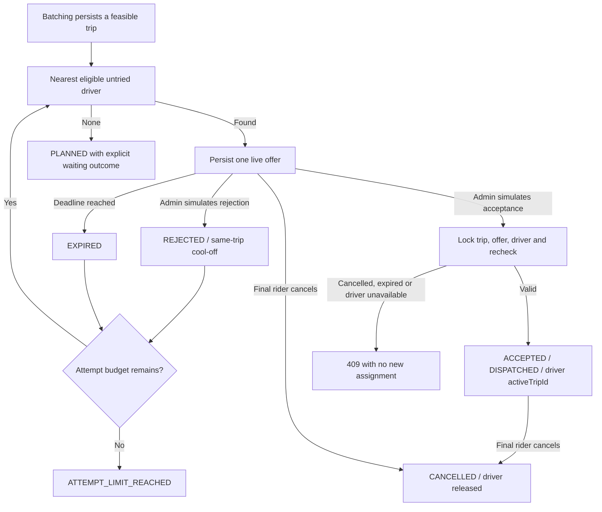

# Trip dispatch and offer responses

Batch formation now calls dispatch for each newly planned trip. An initial offer commits with the route and confirmed bookings. Rejection advances to another eligible driver immediately; acceptance commits the offer, trip assignment and driver's active-trip link atomically. These are operations inside the existing Spring Boot application, with no messaging infrastructure.



## Identity and entry points

The project has employee/admin/approver accounts, without a driver authentication model. Accordingly, all dispatch HTTP operations are **ADMIN-only simulations of the stored driver's response**. The authenticated admin is the actor; an `offerId` identifies the previously selected driver. No arbitrary driver identity, pickup location or employee header comes from the request. These controls do not claim to deliver a notification or prove a real driver received it.

After obtaining an admin JWT with `POST /auth/login`, use these requests in Swagger's **Admin (Dispatch simulation)** group or an HTTP client. All POST operations below have no body. Bookings, employees, drivers and active zones must already exist; startup does not provision business data.

PowerShell, with `$adminToken`, `$tripId` and `$offerId` filled from real responses:

```powershell
# Plan eligible requests; new trips attempt their first offer automatically.
curl.exe -X POST http://127.0.0.1:8080/api/admin/batching/trigger -H "Authorization: Bearer $adminToken"

# Find routes, booking grouping, peak occupancy and offer IDs.
curl.exe 'http://127.0.0.1:8080/api/admin/dispatch/trips?page=0&size=20' -H "Authorization: Bearer $adminToken"
curl.exe "http://127.0.0.1:8080/api/admin/dispatch/trips/$tripId" -H "Authorization: Bearer $adminToken"

# Reject the current offer. The response identifies the next offer or waiting outcome.
curl.exe -X POST "http://127.0.0.1:8080/api/admin/dispatch/offers/$offerId/reject" -H "Authorization: Bearer $adminToken"

# Replace $offerId with the returned activeOfferId before accepting.
curl.exe -X POST "http://127.0.0.1:8080/api/admin/dispatch/offers/$offerId/accept" -H "Authorization: Bearer $adminToken"

# Explicitly retry a waiting trip after driver availability changes, or process due expiry.
curl.exe -X POST "http://127.0.0.1:8080/api/admin/dispatch/trips/$tripId/advance" -H "Authorization: Bearer $adminToken"
```

`tripStatus=PLANNED` with an `OFFERED` outcome is expected: pending offers do not change trip status. `DISPATCHED` means a driver accepted, not that pickup occurred. `peakPassengers` is simultaneous occupancy, not the selected vehicle's seat limit. `stops` exposes grouping through booking IDs and ordered pickup/dropoff pairs. `assignedDriverId` retains historical assignment on a cancelled trip; it does not mean the driver's active-trip link remains set.

## Policies and outcomes

| Policy | Default and boundary |
| --- | --- |
| Offer lifetime | `dispatch.offer-lifetime=PT2M`; valid only while current time is **strictly before** persisted `expiresAt`. Equality is expired. |
| Attempt budget | `dispatch.max-offers-per-trip=3`, valid range 1–100. Each persisted offer consumes one attempt, including rejection/expiry; calls themselves do not consume attempts. |
| Driver reuse | A driver in any offer history for this trip is never selected again. Cool-off expiry does not restart the round or reset its budget. |
| Cool-off | Existing five-minute same-driver/same-trip exclusion starts at rejection time. This is not a fleet-wide driver ban; a different trip may consider that driver. The no-repeat rule is stronger for the rejected trip. |
| Expiry processing | Independently enabled by default: `dispatch.expiry-scheduling.enabled=true`, fixed delay `interval-ms=5000`, at most `max-trips-per-cycle=100` (range 1–1000). Each due trip advances in its own transaction. |
| Selection | Offline, on-break, active-trip, insufficient-capacity and excluded drivers are filtered; Haversine distance from the stored first pickup then UUID breaks ties. Offers are provisional and do not reserve a driver across trips. |

| Outcome | Meaning / next action |
| --- | --- |
| `OFFERED` | A stored offer is awaiting a response. Retrying Advance returns the same live offer. |
| `OFFER_EXPIRED` | A read observes the outstanding offer at/after its deadline. The job, Advance or attempted response processes expiry; GET never mutates. |
| `NO_ELIGIBLE_DRIVER` | No initial offer and no currently eligible untried driver. Trip remains planned; change availability and Advance. |
| `DRIVERS_EXHAUSTED` | Offers were attempted and no currently eligible untried driver remains. This includes all available drivers rejecting. A newly available untried driver can still be considered if budget remains. |
| `READY_FOR_RETRY` | No live offer, but an eligible untried driver is now available. Advance explicitly; reads do not create offers. |
| `ATTEMPT_LIMIT_REACHED` | The persisted history has consumed the configured budget. No further offers; inspect/recover operationally. No reset or automatic escalation exists. |
| `IN_PROGRESS` / `COMPLETED` | Admin-simulated execution has started / all riders dropped; completion releases the driver. |
| `ASSIGNED` | Accepted offer, dispatched trip and driver's active-trip link were committed together. |
| `CANCELLED` / `TRIP_NOT_PLANNED` | Cancelled or otherwise ineligible trip state; Advance returns state without offering it. |

The job scans only due outstanding offers. It does not continually retry empty eligibility rounds. Calls cannot repeat a driver or exceed the attempt budget. Restarting the application preserves history/deadlines; there is no in-memory retry counter. Raising the configured budget permits additional distinct drivers, so keep policy changes explicit.

V13 backfills pre-existing offers to `createdAt + 2 minutes`, without modifying historical statuses. Older data may contain multiple outstanding offers: Advance keeps at most one eligible live offer and expires the others; acceptance closes other outstanding offers. PostgreSQL also retains its existing unique accepted-offer constraint. The one-live-offer/no-repeat/budget rules rely on service transactions and the trip row lock, not new database uniqueness constraints; external SQL writers can bypass them.

## Responses, cancellation and races

All response paths acquire trip before offer. Acceptance then locks the driver and rechecks current eligibility and peak occupancy. Competing trips can offer the same driver, but only one can commit that driver's active assignment. Another acceptance then returns `409 STATE_CONFLICT`; the caller can Advance to expire the now-ineligible offer and consider another driver.

Accepting or rejecting an overdue offer returns `409 OFFER_EXPIRED`. **Expiry and next-offer processing intentionally commit despite that error.** Retrieve the trip to find its new state; retrying the stale offer cannot assign its former driver or consume another attempt while a live offer remains. Other transition/locking conflicts roll back normally.

When cancellation removes the last rider, it locks the trip, expires outstanding offers and releases an accepted driver's matching active-trip link. Acceptance and cancellation serialize on the trip. If cancellation wins, acceptance returns `409 STATE_CONFLICT`; if acceptance wins first, cancellation releases that assignment. The final trip is cancelled and no driver remains actively assigned to it. A previously accepted offer can remain ACCEPTED as history; replaying it after cancellation still fails. Partial-rider cancellation keeps the remaining trip and recalculates its arrival estimates. Cancellation closes for the whole trip at the first pickup; see [booking lifecycle](booking-lifecycle.md).

Repeated successful acceptance is idempotent only while its matching active assignment still exists. Rejection replay is idempotent while the trip remains planned. Missing trip/offer returns `404 DISPATCH_NOT_FOUND`; employee/approver callers are forbidden. See [API error contracts](api-design.md).

## Verification

With Docker and JDK 17+ available:

```powershell
.\mvnw.cmd '-Dtest=DispatchWorkflowHttpIntegrationTest,DispatchLifecycleIntegrationTest,DispatchMutationRegressionIntegrationTest,BatchingRollbackIntegrationTest' test
.\mvnw.cmd clean verify
```

On Linux/macOS substitute `./mvnw`. No Compose seed, credentials or manual SQL is needed: tests create disposable reference records and log in through the real HTTP server against PostgreSQL Testcontainers.

- [HTTP workflow test](../src/test/java/com/ridebatching/dispatch/api/DispatchWorkflowHttpIntegrationTest.java): employee login/creation, admin batching, initial offer, rejection/cool-off/next driver, acceptance, cancellation and persisted assignments; no-driver/all-rejection outcomes; exact advertised expiry and committed next offer; every dispatch operation denies non-admins. Two tests hold a real trip row lock until both HTTP workers are waiting, proving one offer under overlapping Advance calls and coherent final state under acceptance/cancellation.
- [Lifecycle test](../src/test/java/com/ridebatching/dispatch/DispatchLifecycleIntegrationTest.java): attempt limit, no repeated driver after cool-off, idempotency, expiry boundary and bounded expiry cycles with an injected clock.
- [Mutation regression](../src/test/java/com/ridebatching/dispatch/DispatchMutationRegressionIntegrationTest.java): driver assignment races, response races, actual seat capacity and rejection-time boundaries.
- [Rollback test](../src/test/java/com/ridebatching/batching/BatchingRollbackIntegrationTest.java): a failed initial offer write rolls back already-flushed routes and booking associations; a later retry succeeds.

The tests use explicit clocks/manual expiry-job invocation; background expiry scheduling is disabled only in the test profile. They establish these interleavings, not every possible execution.

## Remaining limits

There is no driver login or notification delivery. Ordered trip execution is an admin simulation; missed solo promises and cancellation timing risk are automatically escalated, but dispatch exhaustion is not. Driver availability provisioning is still outside HTTP. Selection loads all drivers and checks trip-specific cool-off; a bounded offer budget does not bound fleet scans or lock wait duration. Reading paginated trip views also loads routes/history for each page item.

Pickup SLA/detour are evaluated at planning and insertion time. Acceptance checks expiry, current eligibility and capacity; it does not recompute route feasibility after offer waiting or include driver approach time. A feasible planned trip and accepted offer do not establish actual pickup performance. The [execution/cancellation policy](booking-lifecycle.md) makes statuses reachable but does not measure actual road arrival; these ETA limitations remain before use with real riders.
