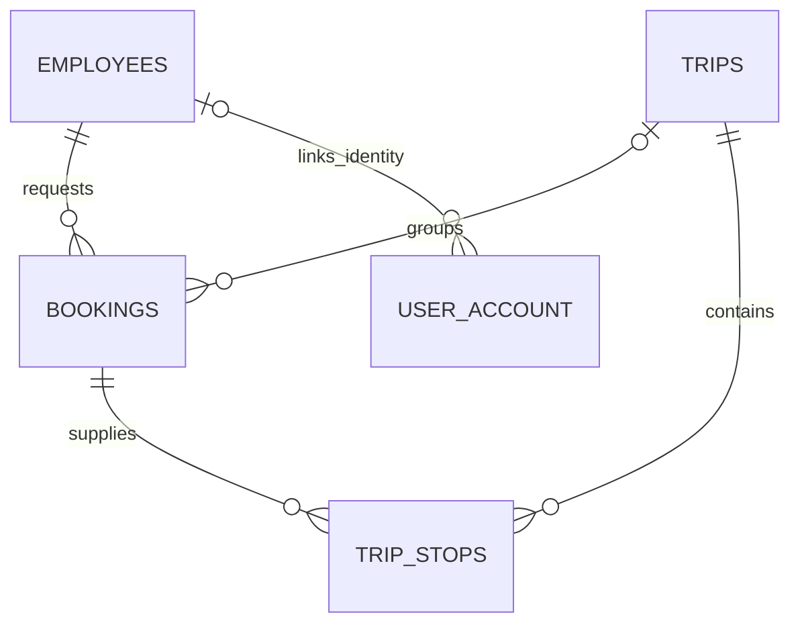
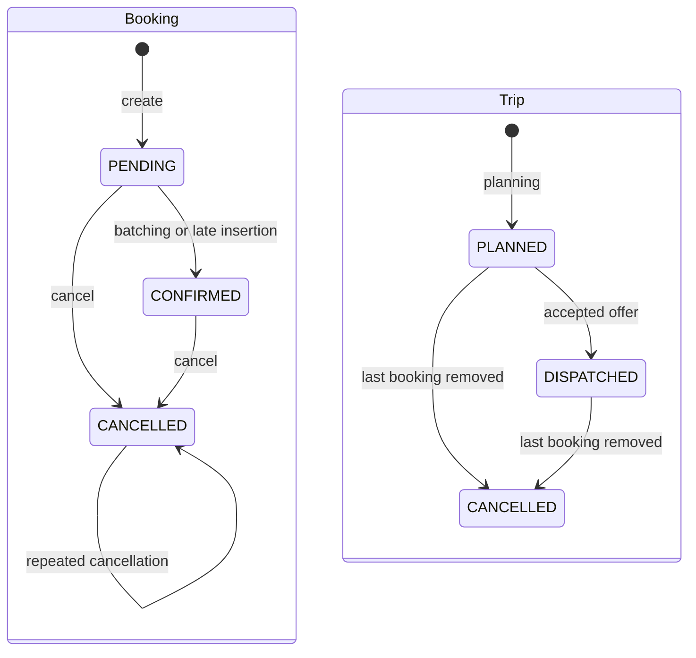

# Implemented Domain Model

Declared enum states do not imply implemented execution flows. The following describes persisted data and reachable operations.

Package responsibilities are in [architecture](architecture.md).

## Stored relationships

These relationships have database foreign keys. Serviceability is computed: bookings store no zone FK. Driver-offer driver/trip IDs, driver active-trip ID, trip driver/vehicle IDs and escalation references are UUID references without DB FKs.

| Entity/table | Persisted fields |
| --- | --- |
| `Employee` / `employees` | UUID, corporate ID, name, email |
| `Booking` / `bookings` | UUID, employee/trip FKs, pickup/dropoff doubles, slot, status, SLA deadline, created timestamp, dedup key |
| `Trip` / `trips` | UUID, status, optional driver/vehicle IDs, window-start field, created/updated timestamps |
| `TripStop` / `trip_stops` | UUID, trip/booking FKs, type, sequence order, latitude/longitude |
| `Driver` / `drivers` | UUID, name, status, location, active trip ID, vehicle capacity, updated timestamp |
| `DriverOffer` / `driver_offers` | UUID, driver/trip IDs, status, created/updated timestamps |
| `ServiceableZone` / `serviceable_zones` | Long ID, name, center coordinates, positive radius, active flag |
| `UserAccount` / `user_account` | UUID, unique username, password hash, role, optional employee FK, timestamps |
| `SlaEscalation` / `sla_escalation` | UUID, reference ID/type, reason, status, timestamps |

## Reachable state transitions

These are service-reachable transitions, not all enum values or setter capabilities. Booking `PICKED_UP`/`DROPPED` and trip `OFFERED`/`IN_PROGRESS`/`COMPLETED` have no execution workflow. A booking already in PICKED_UP can currently be cancelled; DROPPED cannot. Cancelling retains its trip ID. `Trip.windowStartTime` records planning route-start time, not a collection bucket.

`Trip.assignRoute` rejects duplicate pickup/dropoff, missing dropoff and dropoff-before-pickup. It sequences stops from 1 and owns cascaded persistence/orphan removal. Stops have no ETA, arrival or visited fields. `vehicleId` is not populated by the current planner; `Vehicle`/`Capacity` are values, not fleet records.

Driver domain methods support OFFLINE -> AVAILABLE, AVAILABLE -> ON_BREAK, ON_BREAK -> AVAILABLE and going offline when no active trip exists. Assignment retains AVAILABLE and sets activeTripId; `completeTrip` clears that reference, but no application execution flow calls it. There is no BUSY enum state.

Offers transition OFFERED -> ACCEPTED / REJECTED / EXPIRED; repeating accept/reject is allowed at the entity level. The partial unique index enforces at most one ACCEPTED offer per trip, not one outstanding offer or one active trip per driver. Offers have no response deadline; expire has no automatic caller.

Accounts have EMPLOYEE, ADMIN or APPROVER roles and an optional employee link; transport employees have no credentials. Escalations have OPEN/RESOLVED states; only inspection is exposed. See [API](api-design.md), [planning](batching-strategy.md) and [failure boundaries](failure-modes.md).
