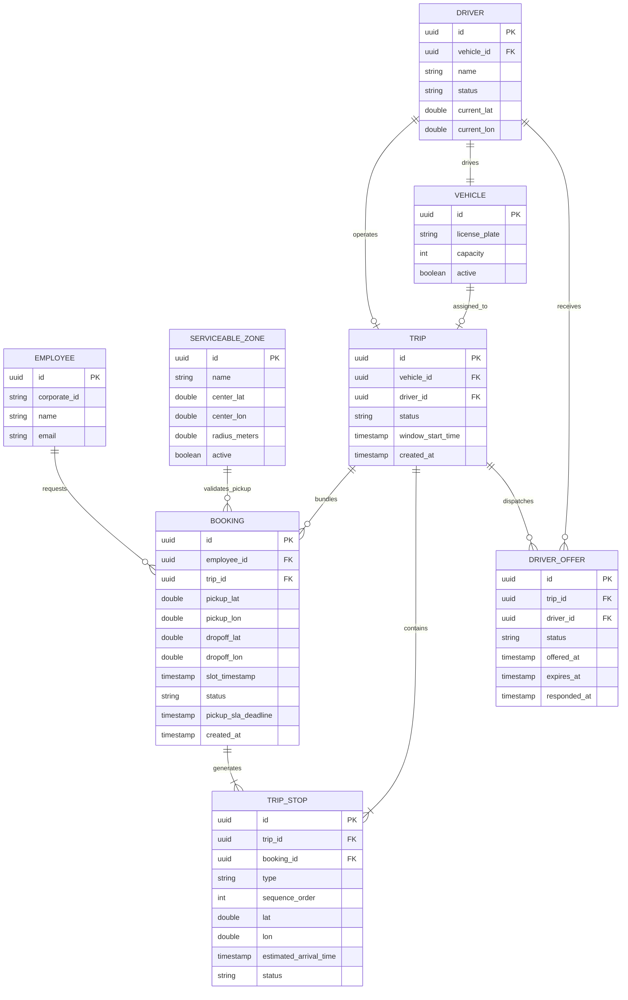
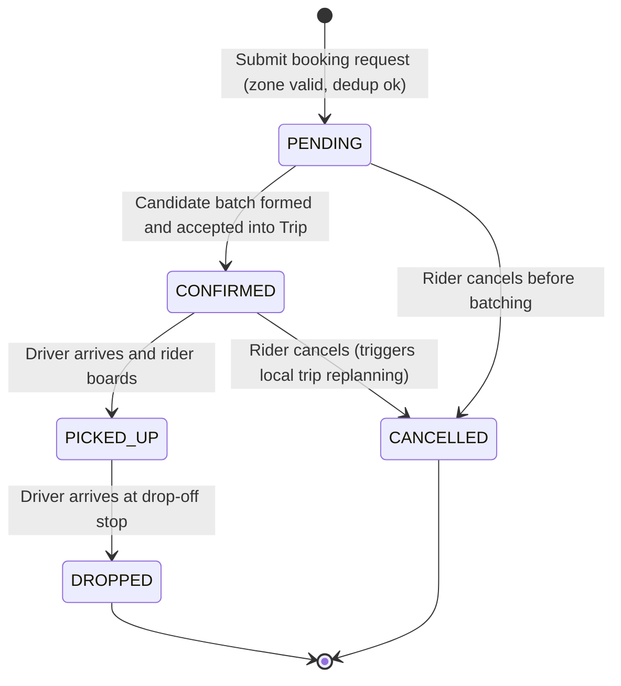
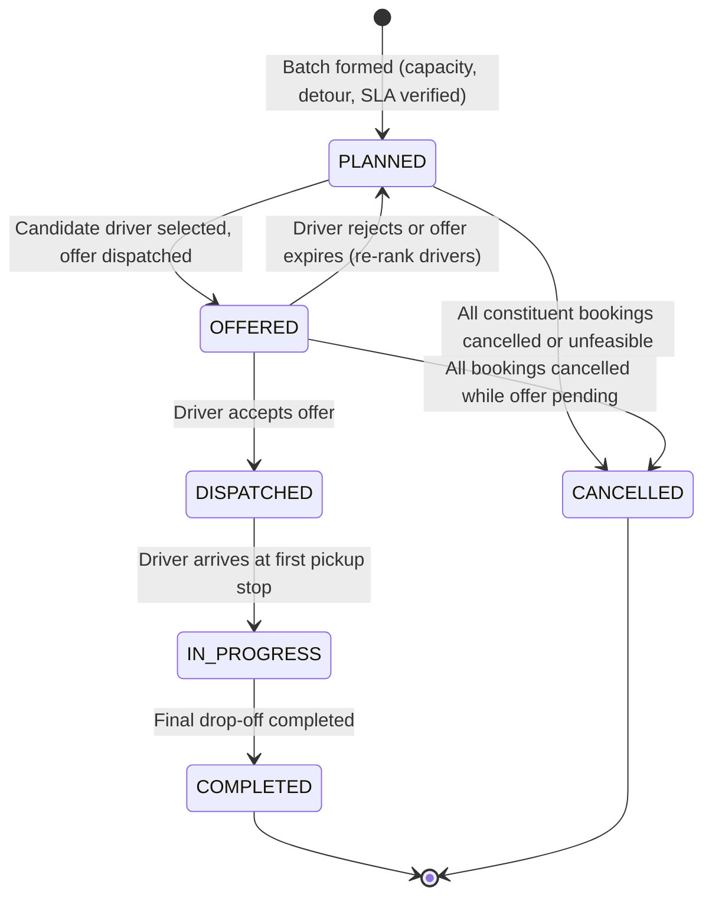
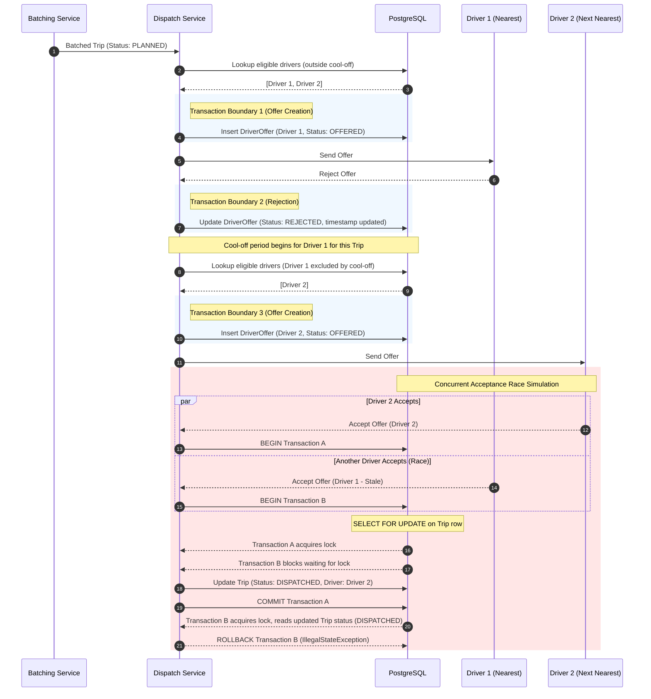
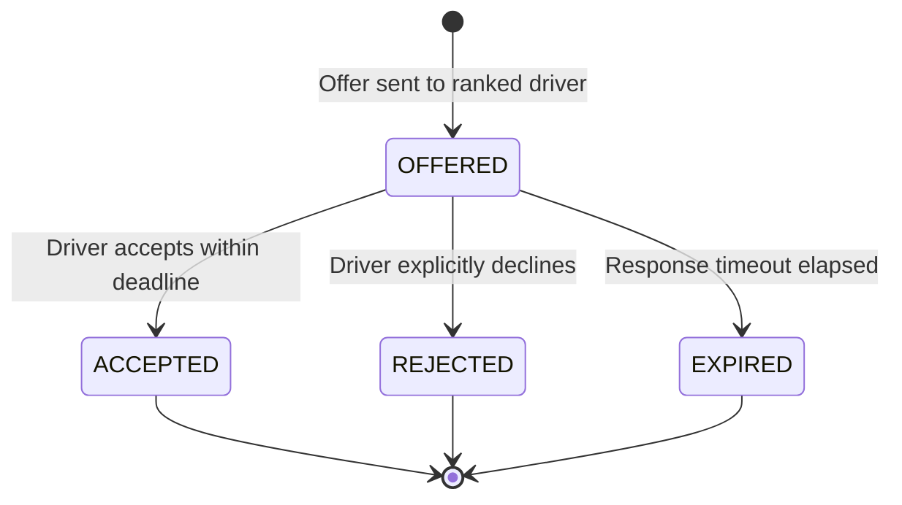

# Domain Model

This document specifies the core domain concepts, entities, value objects, invariants, and lifecycle state machines for the SLA-aware ride batching system.

---

## 1. Domain Entities & Value Objects

### 1.1 Employee
- **Responsibility**: Represents an employee requesting shared commute transportation.
- **Identity**: `id` (UUID / corporate identifier).
- **Fields**:
  - `id`: Unique identifier.
  - `corporate_id`: Company employee identifier.
  - `name`: Employee name.
  - `email`: Corporate email address.
- **Lifecycle**: Static reference entity.
- **Invariants**:
  - Cannot have more than one active booking in the same deduplication slot (enforced via database uniqueness on `Booking`).
  - Transport domain concerns are decoupled from authentication credentials (managed separately in `identity`).

### 1.2 GeoPoint (Value Object)
- **Responsibility**: Represents an immutable geographic coordinate pair on Earth.
- **Identity**: None (equality defined by coordinates).
- **Fields**:
  - `latitude`: Double ($\in [-90.0, 90.0]$).
  - `longitude`: Double ($\in [-180.0, 180.0]$).
- **Invariants**:
  - Coordinate values must fall within valid geographic bounds.
  - Stored at 6 decimal places (~0.1m resolution) for routing calculations; rounded to 4 decimal places (~11m resolution) when evaluating deduplication equality per decision D04.

### 1.3 ServiceableZone
- **Responsibility**: Defines an operational geographic zone where pickups are permitted (Hard constraint H1).
- **Identity**: `id` (UUID).
- **Fields**:
  - `id`: Unique zone identifier.
  - `name`: Descriptive zone label (e.g. "Campus Central", "North Gate").
  - `center`: `GeoPoint` of the circular geofence center.
  - `radius_meters`: Boundary radius in meters ($> 0$).
  - `active`: Boolean flag indicating if requests are currently accepted in this zone.
- **Lifecycle**: Administratively managed (`active` / `inactive`).
- **Invariants**:
  - `radius_meters` must be strictly positive.
  - A booking request is rejected if its pickup `GeoPoint` does not fall within at least one active zone.

### 1.4 Booking
- **Responsibility**: An individual employee's request for transport from a pickup location to a drop-off location within a specific batching window.
- **Identity**: `id` (UUID).
- **Fields**:
  - `id`: Unique booking identifier.
  - `employee_id`: Reference to requesting `Employee`.
  - `pickup_location`: `GeoPoint` (validated against `ServiceableZone`).
  - `dropoff_location`: `GeoPoint`.
  - `slot_timestamp`: Normalized start timestamp of the 15-minute batching window (Instant per D03).
  - `status`: Lifecycle state (`PENDING`, `CONFIRMED`, `PICKED_UP`, `DROPPED`, `CANCELLED`).
  - `pickup_sla_deadline`: Instant representing the promised pickup deadline (`created_at + 20 minutes` per D02).
  - `trip_id`: Optional reference to assigned `Trip` (set upon batch formation).
  - `created_at`: Creation timestamp.
  - `updated_at`: Last modification timestamp.
- **Invariants**:
  - Pickup location must fall within an active `ServiceableZone` at creation time (H1).
  - Composite uniqueness on `(employee_id, normalized_pickup, normalized_drop, slot_timestamp)` across active bookings enforces single-booking idempotency (H2).
  - Estimated pickup time must not exceed `pickup_sla_deadline` (H4).
  - Cancellation is permitted in `PENDING` and `CONFIRMED` states; prohibited once `PICKED_UP`.

### 1.5 Trip
- **Responsibility**: An orchestrated shared transport journey grouping one or more compatible bookings along a sequenced multi-stop route.
- **Identity**: `id` (UUID).
- **Fields**:
  - `id`: Unique trip identifier.
  - `status`: Lifecycle state (`PLANNED`, `OFFERED`, `DISPATCHED`, `IN_PROGRESS`, `COMPLETED`, `CANCELLED`).
  - `vehicle_id`: Reference to assigned `Vehicle` (optional until dispatch).
  - `driver_id`: Reference to assigned `Driver` (optional until dispatch).
  - `window_start_time`: The batching window from which constituent bookings were gathered.
  - `created_at`: Creation timestamp.
  - `updated_at`: Last modification timestamp.
- **Invariants**:
  - Peak concurrent onboard passengers across all route segments must not exceed the assigned vehicle's capacity (H3, D09).
  - For every passenger, estimated pickup time must not exceed that booking's `pickup_sla_deadline` (H4).
  - For every passenger, travel detour must satisfy relative ($\le 40\%$) and absolute ($\le 15$ minutes) detour limits (D07).
  - Cancelling one booking only replans this specific trip; unrelated trips remain untouched (H7).

### 1.6 TripStop
- **Responsibility**: A sequenced stop along a trip route, representing either a pickup or drop-off for a specific booking.
- **Identity**: `id` (UUID) or composite `(trip_id, sequence_order)`.
- **Fields**:
  - `id`: Unique stop identifier.
  - `trip_id`: Reference to parent `Trip`.
  - `booking_id`: Reference to associated `Booking`.
  - `type`: Enum (`PICKUP`, `DROPOFF`).
  - `location`: `GeoPoint` of the stop.
  - `sequence_order`: 1-based integer order in the itinerary.
  - `estimated_arrival_time`: Calculated ETA.
  - `actual_arrival_time`: Timestamp when driver reached stop (nullable).
  - `status`: Stop status (`PENDING`, `VISITED`, `SKIPPED`).
- **Invariants**:
  - For every booking assigned to a trip, there must be exactly one `PICKUP` stop and one `DROPOFF` stop.
  - Precedence invariant: For any booking $B$, $\text{sequence\_order}(\text{PICKUP}_B) < \text{sequence\_order}(\text{DROPOFF}_B)$.
  - Passenger occupancy delta: A `PICKUP` stop increments onboard passengers by 1; a `DROPOFF` stop decrements by 1.

### 1.7 Vehicle
- **Responsibility**: Physical transport asset with fixed passenger seating capacity.
- **Identity**: `id` (UUID).
- **Fields**:
  - `id`: Unique vehicle identifier.
  - `license_plate`: Registration plate.
  - `capacity`: Maximum passenger capacity (default: 4 seats per D09).
  - `active`: Operational status flag.
- **Invariants**:
  - `capacity` must be $\ge 1$.
  - A vehicle can be assigned to at most one active (`DISPATCHED` or `IN_PROGRESS`) trip at a time.

### 1.8 Driver
- **Responsibility**: Operator operating a vehicle to fulfill trips.
- **Identity**: `id` (UUID).
- **Fields**:
  - `id`: Unique driver identifier.
  - `name`: Driver full name.
  - `status`: Availability state (`AVAILABLE`, `ON_BREAK`, `BUSY`, `OFFLINE`).
  - `current_location`: `GeoPoint` representing last known location.
  - `vehicle_id`: Reference to assigned `Vehicle`.
- **Invariants**:
  - A driver on an active break (`ON_BREAK`) cannot receive a trip offer (Hard constraint H5).
  - A driver cannot receive an offer for a trip they rejected within the cool-off window (Hard constraint H6, D10).
  - A driver can be assigned to at most one active trip at a time.

### 1.9 DriverOffer
- **Responsibility**: A time-bounded offer of a planned trip sent to a specific eligible driver.
- **Identity**: `id` (UUID).
- **Fields**:
  - `id`: Unique offer identifier.
  - `trip_id`: Reference to `Trip`.
  - `driver_id`: Reference to `Driver`.
  - `status`: Lifecycle state (`PENDING`, `ACCEPTED`, `REJECTED`, `EXPIRED`).
  - `offered_at`: Timestamp when the offer was created.
  - `expires_at`: Expiration deadline.
  - `responded_at`: Timestamp of driver response (nullable).
- **Invariants**:
  - At most one `PENDING` offer can exist for a given trip at any moment (sequential dispatch offers).
  - If rejected or expired, records `(driver_id, trip_id, responded_at)` to enforce the cool-off period before dispatching to the next ranked driver.

---

## 2. Domain Relationships (ER Overview)

---

## 3. Lifecycle State Machines

### 3.1 Booking Lifecycle

#### Reconciliation Note on `CANCELLED` State
The original case-study problem statement lists the following four booking states:
- `PENDING`
- `CONFIRMED`
- `PICKED_UP`
- `DROPPED`

However, the case study explicitly specifies cancellation behaviour and invariants:
> *"cancelling one booking replans its trip without modifying unrelated trips (H7)"*

Without a persistent terminal `CANCELLED` state, cancelled bookings would either need to be deleted (destroying audit history, deduplication records, and replanning triggers) or left in an ambiguous active status.

We explicitly extend the domain state model to include **`CANCELLED`** as a terminal state.

**State Transition Rules**:
- `PENDING -> CONFIRMED`: Constituent bookings assigned to a feasible shared `Trip`.
- `PENDING -> CANCELLED`: Allowed; drops booking from pending candidate pool.
- `CONFIRMED -> CANCELLED`: Allowed; removes constituent stops from assigned `Trip` and triggers local route replanning. Unrelated trips remain unaffected.
- `PICKED_UP -> CANCELLED`: **Disallowed**. Once a passenger is in the vehicle, the journey must be completed via `DROPPED`.
- `DROPPED -> CANCELLED`: **Disallowed**. Completed trips cannot be cancelled.

---

### 3.2 Trip Lifecycle

**State Transition Rules**:
- `PLANNED -> OFFERED`: Nearest eligible driver identified (not on break, outside cool-off).
- `OFFERED -> DISPATCHED`: Driver accepts offer within timeout.
- `OFFERED -> PLANNED`: Driver rejects offer or timer expires. Trip returns to pool to evaluate next ranked driver.
- `DISPATCHED -> IN_PROGRESS`: First pickup completed.
- `IN_PROGRESS -> COMPLETED`: All passenger drop-offs completed.
- `PLANNED / OFFERED -> CANCELLED`: Occurs if rider cancellations leave zero passengers or unresolvable route infeasibility.

---

### 3.3 DriverOffer Lifecycle

#### Sequence Diagram (Offer Dispatch & Concurrency)

#### State Diagram

**State Transition Rules**:
- `OFFERED -> ACCEPTED`: Transactionally locks the trip to prevent concurrent assignments. Assigns driver to trip; transitions trip to `DISPATCHED`.
- `OFFERED -> REJECTED`: Logs rejection timestamp for cool-off enforcement; triggers offer to next ranked driver.
- `OFFERED -> EXPIRED`: Dispatches offer to next ranked driver; driver remains eligible for future offers.

---

## 4. Separation of Identity and Transport Concerns

To maintain single-responsibility domain boundaries:
- **Transport domain (`Employee`, `Driver`)**: Encapsulates only physical mobility attributes (pickup/drop locations, ride statuses, vehicle capacities, spatial coordinates).
- **Identity domain (`User`, `Role`, `Credential`)**: Encapsulates authentication credentials (passwords, JWT tokens, API keys) and authorization privileges (`EMPLOYEE`, `DRIVER`, `ADMIN`, `APPROVER`).
- Transport entities reference identity accounts through immutable foreign keys (`user_id`), preventing authentication mechanics from leaking into trip orchestration and batching logic.
