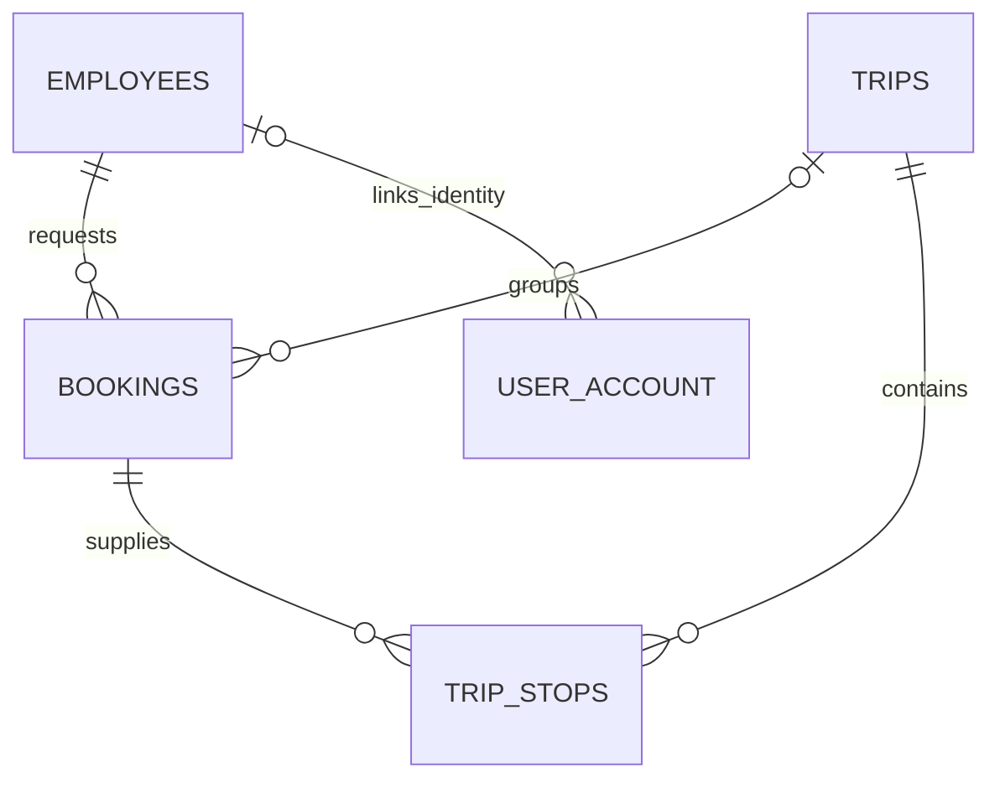

# Implemented Domain Model

Declared enum states do not imply implemented execution flows. The following describes persisted data and reachable operations.

| Package | Responsibility |
| --- | --- |
| `booking` | Employee reference data; booking request, dedup key, slot, pickup deadline and trip association |
| `trip` | Trip/stop aggregate and route insertion search |
| `driver`, `dispatch` | Driver state, location/capacity, selection, offers and assignment |
| `zone`, `geo` | Circular geofences, coordinates, bearing and distance/ETA calculations |
| `fleet` | Non-persisted `Vehicle` and positive `Capacity` planning values; no vehicle table |
| `auth`, `escalation` | Account credentials/roles and exception-record inspection |

## Stored relationships

These relationships have database foreign keys. Serviceability is computed: bookings store no zone FK. Driver-offer driver/trip IDs, driver active-trip ID, trip driver/vehicle IDs and escalation references are UUID references without DB FKs.

| Entity/table | Persisted fields |
| --- | --- |
| `Employee` / `employees` | UUID, corporate ID, name, email |
| `Booking` / `bookings` | UUID, employee/trip FKs, pickup/dropoff doubles, slot, status, SLA deadline, created timestamp, dedup key |
| `Trip` / `trips` | UUID, status, optional driver/vehicle IDs, window-start field, created/updated timestamps |
| `TripStop` / `trip_stops` | UUID, trip/booking FKs, type, sequence order, latitude/longitude |
| `Driver` / `drivers` | UUID, name, status, location, active trip ID, vehicle capacity, updated timestamp |
| `DriverOffer` / `driver_offers` | UUID, driver/trip IDs, status, created/updated timestamps |
| `ServiceableZone` / `serviceable_zones` | Long ID, name, center coordinates, positive radius, active flag |
| `UserAccount` / `user_account` | UUID, unique username, password hash, role, optional employee FK, timestamps |
| `SlaEscalation` / `sla_escalation` | UUID, reference ID/type, reason, status, timestamps |

`Trip.windowStartTime` receives route-start time, not a collection bucket. Stops have no ETA/arrival/visit fields. Offers have no response deadline.

## Invariants and transitions

- PostgreSQL enforces one active booking per dedup key; cancelled rows are excluded.
- `Trip.assignRoute` rejects duplicate pickup/dropoff, missing dropoff and dropoff-before-pickup; sequence starts at 1. Aggregate persistence cascades to stops with orphan removal.
- Feasibility checks structure, peak occupancy, pickup SLA and detour in sequence.
- Booking starts `PENDING`; batching/late insertion sets `CONFIRMED`; cancellation sets `CANCELLED`. `PICKED_UP`/`DROPPED` exist without execution APIs. Cancellation rejects `DROPPED` only.
- Trip starts `PLANNED`; accepted offer sets `DISPATCHED`; removing all bookings sets `CANCELLED`. `OFFERED`, `IN_PROGRESS`, `COMPLETED` are declared but not set by current flows.
- Driver transitions `OFFLINE -> AVAILABLE -> ON_BREAK -> AVAILABLE`; assignment records active trip ID. No `BUSY` state exists. Eligibility checks status and active-trip reference.
- Offer starts `OFFERED`; accept/reject/expire sets `ACCEPTED`/`REJECTED`/`EXPIRED`. Repeating accept/reject is permitted. One accepted offer per trip is DB-enforced; multiple open offers are possible. Expiration has no scheduler.
- Account roles: `EMPLOYEE`, `ADMIN`, `APPROVER`. Current account details are reloaded on authenticated requests.
- Escalation states: `OPEN`, `RESOLVED`. Inspection exists; automatic creation/resolution does not.

See [API contracts](api-design.md) and [trip mutations](trip-mutation-flows.md).
