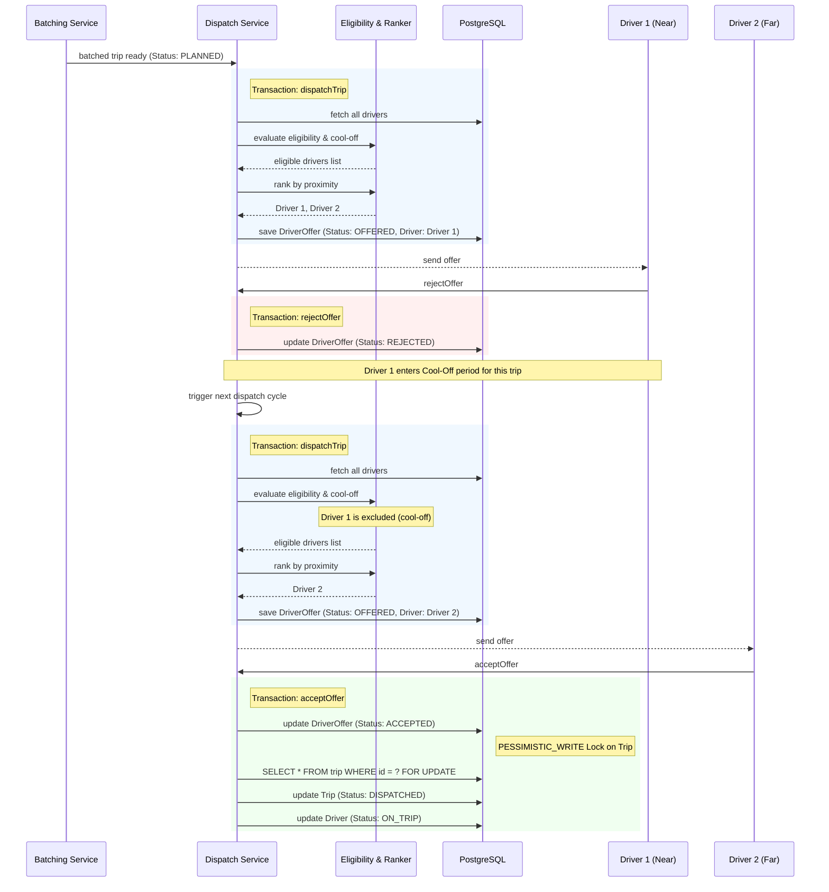
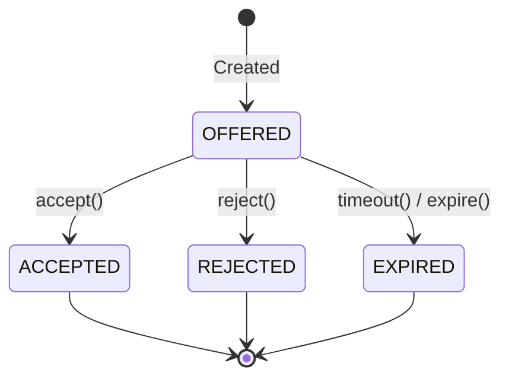

# Driver Dispatch Lifecycle

## Sequence Diagram

This diagram illustrates the process of dispatching a batched trip, handling driver rejections, cool-offs, and final acceptance. It highlights the transactional and concurrency boundaries.

## DriverOffer State Diagram

The `DriverOffer` tracks the lifecycle of an offer made to a driver for a specific trip. 
It ensures that an offer can only be acted upon if it is in a valid state.

