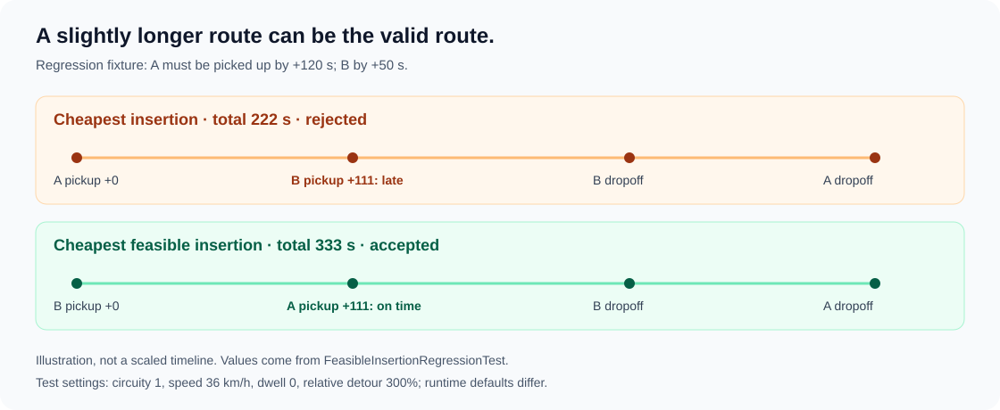

# Choosing a feasible route and validating its ETA

The planner chooses the cheapest **feasible** insertion within each candidate trip, then compares incremental cost across trips. Cost ranks the alternatives that meet the hard constraints; it cannot override a rider's deadline.

## Search and bounds

For S existing stops, insert a pickup and its later dropoff in each of `(S+1)(S+2)/2` positions, preserving all existing stop order. Compute each candidate's duration. Evaluate structure, peak occupancy, every pickup deadline and every rider's detour before retaining it. Once a feasible cost is known, equally or more expensive alternatives cannot improve it and their constraint evaluation is skipped. Equal costs keep the earliest pickup/dropoff insertion indices; equal incremental cost across trips uses trip UUID.

The search streams candidates and retains one best route. Route construction, costing and constraint checks are each O(S), so per-trip search remains O(S³) time and O(S) temporary space. It does not materialize every alternative. New batch input is limited by the claim budget and partitioned by source window, zone and direction. Capacity limits concurrent occupancy, **not total bookings or stops**; passenger turnover and the separate late-insertion path can grow routes. No constant route-size or latency guarantee follows from four seats. Late insertion still scans all planned candidates and repeats search after locking its selected trip.

This is greedy insertion, not a global route optimizer. It explores all insertion positions for the new rider, without reordering existing stops or revisiting earlier grouping decisions. Accepted assignments are not late-insertion candidates.

## Why checking one cheap insertion is insufficient



The [regression](../src/test/java/com/ridebatching/batching/FeasibleInsertionRegressionTest.java) uses the real local estimator with circuity 1, speed 36 km/h and zero dwell. A starts at longitude 0 and drops at .02, with a 120-second pickup budget. B starts at .01 and drops at .019, with a 50-second budget; both latitudes are zero.

| Route | Duration | Pickup result |
| --- | --- | --- |
| A pickup, B pickup, B dropoff, A dropoff | 222 seconds | B pickup at +111 misses +50 |
| B pickup, A pickup, B dropoff, A dropoff | 333 seconds | B at +0; A at +111 meets +120 |

The second route passes the regression's explicitly generous 300% relative/30-minute absolute detour policy. These test settings isolate the SLA/search decision; runtime defaults remain 100%/30 minutes. The test asserts the cheaper route fails, the selected alternative costs more and passes all constraints, and real batch planning uses one trip. A separate case verifies that no feasible insertion leaves the original route untouched.

Five simultaneous pickups with no time for turnover still split into four plus one. With generous deadlines, a four-seat vehicle can legitimately serve five bookings in one trip by dropping riders before later pickups; tests cover both. Splitting is determined by all hard constraints, not a blanket four-bookings-per-trip rule.

## Local timing contract

The configured estimator remains local and deterministic:

```text
driving seconds = floor(Haversine metres × circuity / (speed km/h ÷ 3.6))
route leg       = driving seconds + destination dwell
driver approach = driving seconds, without destination dwell
```

Defaults: circuity 1.35, speed 30 km/h, dwell 120 seconds. A colocated driver's approach is zero. Between route stops, even same-location legs include dwell. No first-pickup dwell is added; this preserves the existing arrival convention. Alternative estimator implementations can override `estimateApproachTime`; its conservative interface fallback uses their whole leg estimate.

| Stage | First pickup time / revalidation |
| --- | --- |
| New-trip planning and unassigned late insertion | Captured cycle/insertion time at first pickup; no driver yet, so this is an optimistic route feasibility screen |
| Offer creation or Advance | `max(current dispatch time, original planning start) + approach from candidate's stored location`; require confirmed associations, structure, actual seats, pickup SLA and detour |
| New acceptance | Reload locked trip, offer and driver; capture current time after acquiring locks, check expiry/eligibility, then repeat all route constraints with the driver's current position/capacity |
| Accepted-trip cancellation before execution | Lock/reload its driver after booking/trip; recompute approach to the revised first pickup, then all arrivals; recheck capacity/detour and flag remaining missed pickup promises |
| Unassigned-trip cancellation | Recalculate from max(current batching time, original planning start), using planning seats |

Approach does not count as passenger detour: detour starts at each rider's pickup. Acceptance persists its recomputed `estimatedArrivalAt` values with offer/trip/driver assignment in one transaction. Pending-offer views still show planning or most recent route-mutation estimates; they are not a commitment from that driver. Offer creation uses provisional driver data, not a reservation; acceptance is the locked, authoritative check.

## Failure policy

Pickup equality passes; a pickup estimate strictly after its promise fails. Offer expiry remains separate: acceptance must arrive strictly before `expiresAt`. A live offer can therefore fail SLA before its offer lifetime ends.

An infeasible new acceptance returns `409 ROUTE_INFEASIBLE` with a controlled constraint code in the message, such as `PICKUP_SLA` or `RELATIVE_DETOUR`. It leaves the offer OFFERED, trip PLANNED, driver unassigned and arrival estimates unchanged. Advance or expiry processing retires an offer that no longer fits and considers an untried feasible driver within the existing attempt budget. GET remains read-only and does not audit every outstanding offer's current feasibility. No feasible driver leaves a planned trip without an assignment; there is no automatic trip splitting or attempt reset at dispatch.

Repeating acceptance of an already active accepted assignment returns its current state; it does not assign again or retimestamp estimates. A completed/cancelled assignment cannot be revived. Empty routes and non-confirmed/mismatched booking associations cannot be offered or newly accepted.

Cancellation retains the [existing remedy policy](booking-lifecycle.md): a missed remaining pickup is escalated rather than silently extending its deadline. Capacity/detour violations reject and roll back the route change with `409 ROUTE_INFEASIBLE`. Cancellation after any pickup remains unsupported. Road traffic, external routing, continuous driver tracking and measured pickup times are outside this assessment; computed feasibility is not an actual service guarantee.

## Verification

Java 17+ and Docker; on Windows use `./mvnw.cmd`:

```sh
./mvnw -Dtest=FeasibleInsertionRegressionTest,BatchPlannerAcceptanceTest,AssignmentTimingHttpIntegrationTest,DispatchMutationRegressionIntegrationTest,BookingLifecycleHttpIntegrationTest,LocalTravelTimeEstimatorTest test
```

[HTTP timing tests](../src/test/java/com/ridebatching/dispatch/api/AssignmentTimingHttpIntegrationTest.java) use real login, batching and authenticated acceptance against PostgreSQL. They prove live-but-too-late acceptance rollback, exact equality, current driver position, changed-route detour checks, approach after cancelling the first stop, current capacity rejection and empty-route refusal. Fixed clocks avoid sleeping. Existing [dispatch races](../src/test/java/com/ridebatching/dispatch/DispatchMutationRegressionIntegrationTest.java) and [lifecycle races](../src/test/java/com/ridebatching/booking/api/BookingLifecycleHttpIntegrationTest.java) remain applicable.

Implementation: [RouteInsertionPlanner](../src/main/java/com/ridebatching/trip/RouteInsertionPlanner.java), [BatchPlanner](../src/main/java/com/ridebatching/batching/BatchPlanner.java), [TripAssignmentValidator](../src/main/java/com/ridebatching/dispatch/TripAssignmentValidator.java), [DispatchService](../src/main/java/com/ridebatching/dispatch/DispatchService.java), [TripRouteTiming](../src/main/java/com/ridebatching/trip/TripRouteTiming.java) and [LocalTravelTimeEstimator](../src/main/java/com/ridebatching/geo/LocalTravelTimeEstimator.java).
