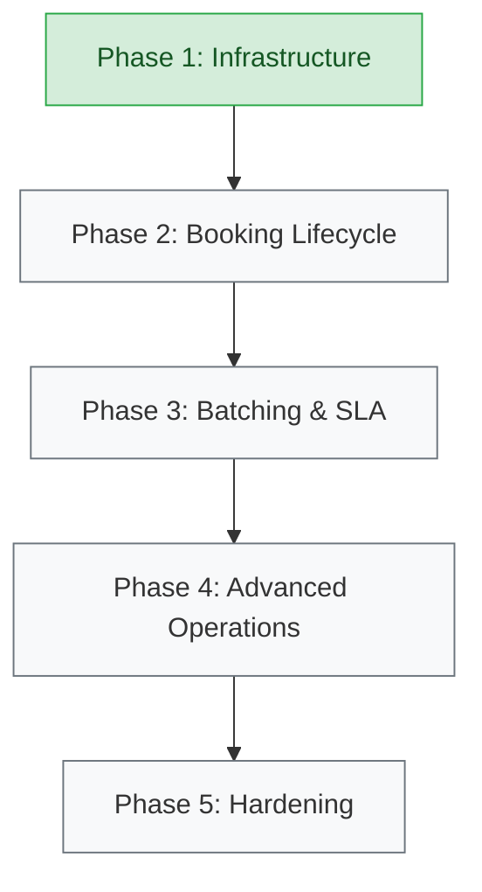

# Project Progress

This document tracks the actual state of the repository, reflecting features that are concretely designed, implemented, and tested.

## Capability Status

| Capability             | Designed | Implemented | Tested | Notes |
| :---                   | :---:    | :---:       | :---:  | :--- |
| project bootstrap      | D        | I           | T      | Maven, Spring Boot 3.3, Java 21, CI Pipeline |
| PostgreSQL environment | D        | I           | T      | Docker Compose, Testcontainers, Flyway |
| booking                | D        | I           | T      | Basic creation API and persistence |
| deduplication          | D        | I           | T      | Deterministic keys, DB race handling |
| serviceability         | D        | I           | T      | Geospatial point-in-polygon matching |
| batching               | —        | —           | —      | |
| SLA                    | —        | —           | —      | |
| detour                 | —        | —           | —      | |
| driver dispatch        | —        | —           | —      | |
| late insertion         | —        | —           | —      | |
| cancellation           | —        | —           | —      | |
| authentication         | —        | —           | —      | |
| observability          | —        | —           | —      | |
| caching                | —        | —           | —      | |
| failure handling       | —        | —           | —      | |

**Legend:**
* **—** : not started
* **D** : designed
* **I** : implemented
* **T** : tested

## Delivery Sequence

The following flowchart indicates where we currently are in the overall delivery sequence.

