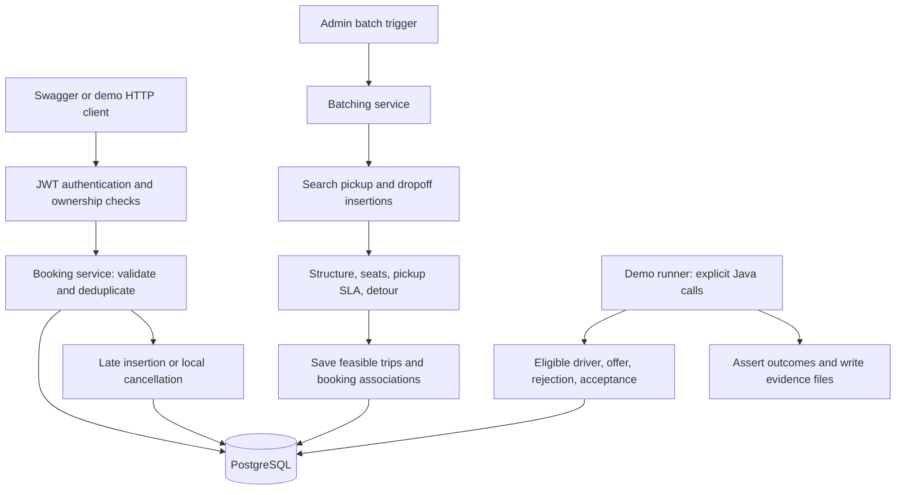

# What this project does and how to demonstrate it

This guide explains the submitted backend in plain language. Use it before the [eight-minute walkthrough](demo-walkthrough.md), which contains the presentation commands. The [requirements matrix](requirements-traceability.md) supplies detailed implementation and test references.

## 1. What you have made

You have made a Java Spring Boot backend for combining employee ride requests into shared cab trips. PostgreSQL stores the bookings, ordered trip stops, drivers and offers. The backend checks whether sharing is safe under its configured capacity, pickup deadline and detour rules.

A useful introduction is:

> I built a backend that groups employee ride requests into shared trips. It treats sharing as an optimization and checks capacity, pickup deadlines and rider detours before accepting a route. I will show the resulting database state and the reasons some combinations are rejected.

There is no passenger website, driver mobile application, map or vehicle animation. Swagger is the generated interface for calling the available HTTP operations. The terminal demo and its evidence files expose behaviour that is implemented in Java services but has no HTTP endpoint.

The artifact you submit is the repository: application source, migrations, tests, reproducible demo and documentation. There is no single HTML file or customer interface to launch. Running the backend starts an HTTP server; opening Swagger then gives you an API playground.

## 2. The real-world situation behind the case study

Imagine several employees requesting a cab around the same time. Each request has a pickup and destination. Combining them could save cab journeys, but the operations team must answer four questions:

1. Is the pickup inside a supported service area?
2. Can these people share without exceeding seats or missing a pickup promise?
3. Which eligible driver should receive the trip, and what happens after rejection?
4. What happens if another employee books late or someone cancels?

An SLA here means the pickup deadline assigned when a booking is created. The default is creation time plus 20 minutes. The planner compares estimated pickup times with that deadline. Its estimates use a simplified distance/speed/dwell model; they do not guarantee real road arrival.

The central rule is **batching is an optimization; capacity, SLA and correctness are constraints**. A shorter or fuller shared route is not accepted if it violates those constraints.

The repository attributes its requirements to *MoveInSync Backend Case Study 2026, Case Study 7: On-Demand Ride Batching*. The original PDF is absent from this checkout. This guide maps to the recorded requirements and actual code; it cannot independently confirm whether the original assignment required a frontend or any additional deliverable.

## 3. The words used in the output

| Word | Meaning in this application |
| --- | --- |
| Employee | A person for whom a ride is requested. An employee record and a login account are separate records. |
| Booking | One person's pickup/dropoff request, deadline, status and optional trip association. |
| Trip | A planned route that can contain multiple bookings. |
| Stop | One ordered pickup or dropoff belonging to a booking. |
| Peak passengers | The largest number simultaneously onboard along that route. Capacity limits this number, not the total number of stops. |
| PENDING booking | Saved, but not assigned to a trip. |
| CONFIRMED booking | Associated with a planned/assigned trip. It does not mean the passenger has physically been picked up. |
| PLANNED trip | A route exists; no accepted driver assignment is required yet. |
| DISPATCHED trip | A driver has accepted the offer and is assigned in the database. It does not prove a notification was delivered or a cab moved. |
| Offer | A persisted proposal to a driver, with an OFFERED, REJECTED or ACCEPTED outcome. |
| Cool-off | Temporary exclusion of a rejected driver for the same trip. |
| Assertion | A check that fails the demo if the observed outcome differs from the required outcome. |

## 4. How the parts connect



A booking request passes authentication and serviceability checks, then is inserted or matched to an existing logical request. Creation can also attempt insertion into an existing planned trip. Otherwise the request remains pending until batching.

Batching claims pending rows, sorts by deadline, searches insertion positions and evaluates constraints. A feasible shared route is saved. If sharing fails, it tries a solo route; if that fails too, the request remains pending. Batching does not automatically invoke dispatch.

The separate dispatch service filters/ranks drivers and records offers. Explicit service calls reject, re-offer and accept in the demo. Acceptance coordinates the trip, offer and driver state in a transaction.

## 5. Files that matter

Paths below are relative to the repository root. They are navigation pointers, not a requirement to read every source file during a presentation.

| File or directory | Responsibility and what to explain |
| --- | --- |
| [README.md](../README.md) | Front door: scope, algorithm summary, run/test commands and limitations. |
| [pom.xml](../pom.xml) | Java/Maven dependencies, application build and test setup. The wrapper supplies Maven. |
| [docker-compose.yml](../docker-compose.yml) | PostgreSQL service. The demo reuses it with an isolated project, database and port. |
| [application.yml](../src/main/resources/application.yml) | Runtime policy: pickup SLA, seats, estimated travel, detour limits, scheduling and metrics. |
| [BookingController.java](../src/main/java/com/ridebatching/booking/api/BookingController.java) | HTTP booking operations and ownership checks. |
| [BookingService.java](../src/main/java/com/ridebatching/booking/BookingService.java) | Creation, retrieval, serviceability, duplicate handling, late insertion and cancellation. |
| [DeduplicationKeyGenerator.java](../src/main/java/com/ridebatching/booking/DeduplicationKeyGenerator.java), [BookingRepository.java](../src/main/java/com/ridebatching/booking/BookingRepository.java) | Define logical identity and use database-arbitrated insertion rather than a vulnerable check-then-insert. |
| [ServiceabilityService.java](../src/main/java/com/ridebatching/zone/ServiceabilityService.java) | Active circular pickup-zone checks and cached zone lookup. |
| [BatchingService.java](../src/main/java/com/ridebatching/batching/BatchingService.java) | Claims rows, orchestrates planning and persists results transactionally. |
| [BatchPlanner.java](../src/main/java/com/ridebatching/batching/BatchPlanner.java), [RouteInsertionPlanner.java](../src/main/java/com/ridebatching/trip/RouteInsertionPlanner.java) | Greedy grouping and ordered pickup/dropoff insertion search. |
| [TripFeasibilityEvaluator.java](../src/main/java/com/ridebatching/batching/evaluator/TripFeasibilityEvaluator.java) | Checks route structure, capacity, pickup SLA and detour; returns rejection details and emits decision logs. |
| [Trip.java](../src/main/java/com/ridebatching/trip/Trip.java) | Owns ordered stops and removes/resequences the cancelled booking's stops. |
| [DispatchService.java](../src/main/java/com/ridebatching/dispatch/DispatchService.java) | Driver offers, rejection and atomic acceptance. Driver policies and cool-off live in adjacent feature packages. |
| [SecurityConfig.java](../src/main/java/com/ridebatching/auth/SecurityConfig.java), [AuthController.java](../src/main/java/com/ridebatching/auth/AuthController.java) | JWT access rules and BCrypt-backed login. |
| [OpenApiConfig.java](../src/main/java/com/ridebatching/config/OpenApiConfig.java) | Swagger title and bearer-token scheme. springdoc generates the endpoint documentation from controllers/DTOs. |
| [db/migration](../src/main/resources/db/migration) | Flyway schema and database invariants, including keys, uniqueness and stop constraints. |
| [src/test/java](../src/test/java) | Unit and real-PostgreSQL tests for rules, rollback, ownership and forced concurrency races. |
| [scripts/demo/demo.py](../scripts/demo/demo.py) | Starts/resets/stops the isolated demo, checks prerequisites and runs the opt-in demonstration test. |
| [ReviewerDemoTest.java](../src/test/java/com/ridebatching/demo/ReviewerDemoTest.java) | Seeds disposable fixtures, makes real HTTP/service calls, asserts outcomes and writes observed evidence. |
| [application-demo.yml](../src/test/resources/application-demo.yml) | Test-only loopback/readiness/logging configuration. Demo code/configuration is excluded from the application JAR. |
| `target/demo/` | Regenerated local outputs: stage JSON, combined `evidence.md`, application log and Prometheus scrape. Not committed application source. |

## 6. Decisions made, and why

| Decision | Reason | Compromise |
| --- | --- | --- |
| One Spring Boot application with feature packages | Keeps HTTP, domain logic and transactions inspectable for a backend assessment. | No distributed dispatch infrastructure. |
| PostgreSQL owns uniqueness and row locks | Two requests/workers can race; application-only absence checks cannot arbitrate across callers. | Correctness depends on database constraints and transaction discipline. |
| Logical booking identity includes employee, normalized endpoints and a 15-minute UTC slot | A repeated logical booking returns the existing active request. | This is chosen dedup policy, not a client-supplied idempotency key; distinct requests can normalize to the same identity. |
| Greedy insertion, with feasibility before acceptance | Gives an understandable planner with explicit rejection reasons. | Only the cheapest insertion per trip is checked; a more expensive feasible option or global optimum can be missed. |
| Local distance/speed/dwell ETA | Makes the assessment reproducible without a paid routing API. | No road graph, traffic or driver approach estimate. |
| Four planning seats and one person per booking | Exercises the case-study capacity example; dispatch separately checks actual driver capacity. | No physical vehicle allocation is made during batching. |
| Five-minute rejection cool-off, scoped to driver and trip | Avoids immediately offering the same rejected trip to that driver. | Re-offering requires another explicit call; there is no automatic loop. |
| Cancellation removes/resequences only the affected route | Preserves unrelated trips and existing remaining stop order. | No fresh optimization or execution-time ETA recheck. |
| Script plus an opt-in test runner | Reproduces difficult states without manual database editing or new product endpoints. | Some stages are service-level demonstrations rather than Swagger interactions. |

The [assumptions](assumptions.md), [deduplication decision](decisions/0005-handle-booking-deduplication.md) and [algorithm analysis](algorithm-analysis.md) explain these choices in more detail. A 15-minute dedup slot exists, but runtime batching currently claims all pending rows; window/zone/direction orchestration is not integrated.

## 7. How each case arises and how the demo creates it

The runner creates controlled inputs to make the cases repeatable. It does not print prewritten successful responses. It runs the application, checks the observed state and writes evidence only as stages succeed. Logical outcomes are repeatable; UUIDs, timestamps and equal-cost stop order need not be identical between runs.

| Case in practice | Controlled input/action | Evidence and result to point out |
| --- | --- | --- |
| An employee double-clicks or retries a booking | Submit R1 twice for the same employee/endpoints/slot. | `04-deduplication.json`: matching IDs, employee listing count one and database count one. Concurrent retries have separate PostgreSQL test coverage. |
| An employee requests an unsupported pickup | Submit pickup `(0, 0)`. | `05-zone-error.json`: 422 `UNSERVICEABLE_ZONE`, explanation and no extra saved booking. |
| Five riders need the same overlapping journey in a four-seater | Create R1–R5 before manually triggering batching, all with the same pickup and long common destination leg. | `07-capacity-decision.json` rejects peak five; `08-four-plus-one.json` records two trips with peaks four and one. Capacity measures overlap, so five bookings do not universally imply a split. |
| Nearby riders have already waited and are close to their pickup deadlines | Create new queued S1/S2 fixtures with 90 seconds remaining; each estimated stop leg includes 120 seconds dwell. Probe both pickup orders, then trigger the actual planner. | `09-sla-split.json`: both combined orders violate `PICKUP_SLA`; two feasible solo trips are saved. A first co-located pickup is at route start, while the next includes dwell. |
| The nearest driver has to be checked for suitability | Supply nearby online drivers with four/two seats plus an offline driver. Dispatch the four-rider trip. | `10-eligible-offer.json`: four-seat driver 101 gets the offer; insufficient/offline drivers do not. |
| A suitable driver refuses the trip | Reject driver 101's offer, inspect cool-off, explicitly dispatch again. | `11-reject-and-exclude.json` and `12-next-driver.json`: REJECTED, exclusion now, then backup driver 102 offered. The demo does not wait five minutes; expiry is covered by tests. |
| The backup driver agrees | Accept driver 102's offer. | `13-acceptance.json`: ACCEPTED offer, DISPATCHED trip and matching driver active-trip association. |
| A new employee books after a planned trip already exists | Submit L1 for employee 6 through HTTP after the first batches. | `14-late-insertion.json`: joins R5's existing planned trip, two stops become four, peak one becomes two, without another batch trigger. It does not join the dispatched full trip. |
| That late rider cancels | Cancel L1 through HTTP, compare affected and unrelated trips. | `15-cancellation-isolation.json`: affected stops go from four to two and resequence; `unrelatedExactlyEqual` is true for the dispatched four-rider trip's full captured snapshot. |
| A reviewer asks whether operations are observable | Read real counters and committed final state. | `16-metrics.json`, `17-final-state.json`: eight booking rows including one cancelled, four trips and two offers. Candidate rejection counters are not customer rejection counts. |

Fixture pickup is `(12.9716, 77.5946)`, dropoff `(12.8000, 77.5946)`, with a 5 km active circular zone around pickup. Employees 1–5 are R1–R5; employee 6 is L1; employees 7/8 are S1/S2. Drivers 101/102 are online four-seaters, 103 is an online two-seater, and 104 is offline.

S1/S2 are newly seeded domain requests representing an existing queue, approximately 18 minutes 30 seconds old with a 20-minute pickup promise. They are not edits to existing HTTP bookings. The booking HTTP input has no deadline field, so this setup avoids a lengthy live wait while still using the real evaluator, planner and persistence.

## 8. What Swagger shows: every implemented operation

Swagger reads `/v3/api-docs` and displays seven business operations under these four groups. It is not a simulated passenger/driver screen.

| Group | Method and path | What clicking Execute does | Access |
| --- | --- | --- | --- |
| Authentication | `POST /auth/login` | Checks username/password and returns `{"token":"..."}`. | Public |
| Employee (Bookings) | `POST /api/v1/bookings` | Creates or returns a logical booking; can attempt immediate late insertion. | Admin or matching employee identity; employee header required |
| Employee (Bookings) | `GET /api/v1/bookings` | Lists one employee's bookings with pagination. | Admin or matching employee identity; employee header required |
| Employee (Bookings) | `GET /api/v1/bookings/{id}` | Reads a booking by its returned UUID. | Owner or admin |
| Employee (Bookings) | `DELETE /api/v1/bookings/{id}` | Cancels the booking and changes its affected trip. | Admin or matching employee identity; supplied employee must own the booking |
| Admin (Batching) | `POST /api/admin/batching/trigger` | Executes a batch cycle; returns counts considered, formed and pending. | Admin |
| Approver (Escalations) | `GET /api/v1/escalations/open` | Reads existing open escalation records. | Admin or approver |

Escalation reading is implemented, but batching does not automatically create escalation records. An empty list does not prove a complete escalation workflow. The deterministic demo seeds no approver account; its admin can read this endpoint.

There are no trip-read, driver-offer/reject/accept, map, zone-management or ride-execution HTTP operations. Swagger therefore cannot show the full demo through clickable operations alone. Actuator health/metrics are available at their own URLs; do not expect them among the seven business operations.

### Understanding the buttons

| Control | Meaning |
| --- | --- |
| Endpoint row | Expand it to see inputs, documented responses and schemas. |
| Try it out | Enable input editing. Nothing is sent yet. |
| Execute | Make a real request. POST/DELETE can change the database. |
| Server response / Response body | Actual status and returned JSON from that request. |
| Example Value / Schema | Documented shape; not proof that the request has run or that sample values are valid. |
| Authorize | Set the token used for subsequent protected calls. |
| Schemas | Data structures such as BookingRequest/BookingResponse. These are not additional operations. |

### A simple live inspection after PASS

1. Open `http://127.0.0.1:18080/swagger-ui/index.html` while `run --hold` remains open.
2. Expand **Authentication → POST /auth/login → Try it out**. Enter:

   ```json
   {"username":"reviewer-rider","password":"demo-only-password"}
   ```

3. Click **Execute**. Copy only the string value of `token`, without quotes.
4. Click **Authorize**, paste that JWT into `bearerAuth`, then **Authorize → Close**. This scheme adds `Bearer` itself; paste the token without an extra `Bearer ` prefix. Login alone does not populate this dialog.
5. Expand **Employee (Bookings) → GET /api/v1/bookings → Try it out**. Set `X-Employee-Id` to `00000000-0000-0000-0000-000000000001`. If a pageable object is shown, use `{"page":0,"size":20}`; otherwise use the corresponding page/size fields.
6. Click **Execute**. The completed demo's R1 should be CONFIRMED with a trip ID. The earlier evidence file records its original PENDING state; these are different points in time.
7. Copy that booking's `id` into **GET /api/v1/bookings/{id}** and execute to inspect it individually.

For admin operations, log in as `reviewer-admin` with the same disposable password and replace the token through Authorize (Logout the prior authorization if necessary). The rider account cannot trigger batching or read escalations.

The create input contains pickup and dropoff latitude/longitude only. Employee identity is a header; slot, deadline and status are server-assigned. A Swagger sample containing zero coordinates is not a valid service-zone fixture.

After PASS, batching has already happened: another trigger may consider zero pending bookings, and recreating a cancelled request can insert a new booking. These live mutations are not a replay of the earlier stages. Use the captured stage outputs to explain the sequence and keep live inspection to GET operations after login.

## 9. Start, open and present

Prerequisites: JDK 17+, Python 3.9+, Docker with Compose, and a running Docker daemon. From PowerShell:

```powershell
cd "<your checkout directory>"
python scripts/demo/demo.py reset
python scripts/demo/demo.py run --hold
```

Reset removes the dedicated demo project's disposable database volume. If a previous held run is active, stop it first with `python scripts/demo/demo.py stop`. Run starts PostgreSQL on port 55432 and the application on loopback port 18080, executes all stages, then keeps the server alive after PASS. There are no interactive pauses between stages.

Open Swagger in Chrome, and open `docs/demo-walkthrough.md` plus `target/demo/evidence.md` in your editor. In VS Code, Markdown preview is Ctrl+Shift+V. These Markdown files are documents; Swagger is the running web interface. The walkthrough has an approximately eight-minute script with commands for each captured stage.

Use a second PowerShell window at the repository root to display a result clearly:

```powershell
python -m json.tool target/demo/08-four-plus-one.json
python -m json.tool target/demo/09-sla-split.json
python -m json.tool target/demo/15-cancellation-isolation.json
```

Point to `riders`, `seats`, `peakPassengers` and ordered `stops` for grouping; affected booking, estimated pickup and deadline for SLA; before/after and `unrelatedExactlyEqual` for cancellation. These are actual captured results, not new requests or a live state refresh.

Read-only live operational URLs:

- `http://127.0.0.1:18080/actuator/health/readiness`
- `http://127.0.0.1:18080/actuator/metrics/bookings.deduplication_hits`
- `http://127.0.0.1:18080/actuator/prometheus`

Stop afterward with `python scripts/demo/demo.py stop`. Running `mvnw.cmd clean verify` removes target outputs; regenerate the demo afterward if you need evidence captures.

### Why Chrome showed HTTP 400

The inspected application log recorded `IllegalArgumentException: Request header is too large`. A direct request to `http://127.0.0.1:18080/swagger-ui/index.html` returned HTTP 200, and the live OpenAPI schema returned the seven operations above. The failure was a rejected oversized HTTP request, not a failed scenario assertion or missing Swagger route.

Stored browser cookies are a plausible source of the oversized headers; that specific source was not measured. Try the `127.0.0.1` URL in a Chrome Incognito window. If necessary, clear site data specifically for the affected local host using Chrome settings. No server header-limit or application code change is needed to test that explanation. The root `/` is not a homepage.

## 10. Why this is useful evidence, and what it does not prove

This is a valid demonstration of the implemented backend behaviours because it creates meaningful inputs, executes real HTTP/Java service paths against PostgreSQL, and checks resulting identity, membership, route, assignment and isolation. HTTP success codes alone would not establish those facts. Reviewers can inspect the runner and rerun it from a clean database.

Three forms of evidence serve different purposes:

| Evidence | Establishes | Boundary |
| --- | --- | --- |
| Swagger/manual HTTP | Contract shape, authentication and individual requests/responses. | Only implemented HTTP operations; clicking 200 is not proof of complete grouping/dispatch. |
| Deterministic scenario | Difficult sequential cases and persisted outcomes with assertions. | Synthetic fixtures and simplified ETA; no concurrent traffic, real driver notification or vehicle motion. |
| Automated PostgreSQL tests | Specific forced races, uniqueness, rollback and mutation invariants. | Separate from the live scenario; not every possible race or a deployment/load guarantee. |

Capacity and detour constraints, database-arbitrated duplicates, concurrent batching and transactional assignment are engineering strengths reviewers can investigate through code and tests. Detour rejection has dedicated tests, but no separate rejection stage in this demo.

The repository does **not** fully implement every recorded workflow: runtime window/zone/direction clustering, automatic dispatch/re-offer/escalation creation, escalation resolution, driver/trip HTTP interfaces, pickup/dropoff execution, real road ETA and execution-time cancellation replanning remain gaps. Cancellation here means stop removal and resequencing. Late insertion is limited to planned trips. Consult the requirements matrix for partial statuses rather than presenting the entire assignment as complete.

A visual route/decision viewer could make the explanation easier, but none has been built. The existing compact diagrams explain flow; Swagger displays contracts and JSON. If the original rubric requires a visual application or simulation, this backend demo alone would not satisfy that requirement.

## 11. Questions to be ready to answer

- **Why not put five riders in one cab?** The constructed shared leg has five simultaneous passengers and only four planning seats. A route serving five people at different times is a different capacity case.
- **Why split two riders at the same place?** Their deadlines are close; the estimated second pickup includes dwell that exceeds the remaining budget. Geography is insufficient to prove timing feasibility.
- **Why no automatic driver message?** Offer persistence/eligibility/acceptance exist as services; notification transport and automatic dispatch orchestration are outside the implemented scope.
- **What if two users retry simultaneously?** Database uniqueness arbitrates logical identity. A separate real-PostgreSQL concurrent test verifies this, while the live demo repeats sequentially.
- **What if two workers batch the same booking?** Pending rows are claimed with `FOR UPDATE SKIP LOCKED`; persistence is transactional. Race and rollback tests inspect committed outcomes.
- **Is the route optimal?** No. It is a greedy insertion approach with documented search limitations and hard feasibility checks.
- **Is this the whole case study?** It demonstrates implemented core cases and records the remaining workflow gaps. The original assignment must be checked for submission requirements, including any frontend requirement.
