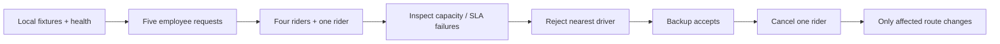
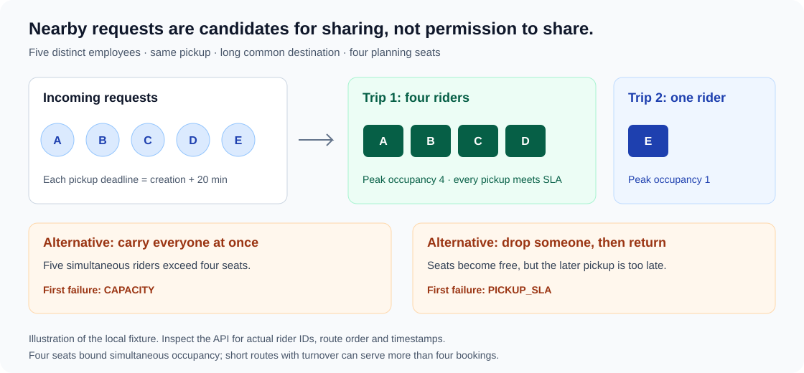

# Review the working system

This project is an SLA-aware ride-pooling backend for employee transit. It groups on-demand ride requests into feasible shared routes within vehicle capacity and SLA constraints, and coordinates driver dispatch through an offer state machine. 

To review the system, you can use the [Interactive Reviewer Console](reviewer-ui.md) at `http://127.0.0.1:8080/`, explore endpoints via [Swagger UI](http://127.0.0.1:8080/swagger-ui/index.html), or run the automated terminal script below. All three paths interact with the live Spring Boot backend.

Use the [public local setup](local-development.md) from a fresh clone and empty disposable database. For an unattended check run `python scripts/local-review.py`. For a 6–10 minute explanation, run:

```sh
python scripts/local-review.py --pause
```

The script performs mutations and pauses at four inspection points. Use Swagger GET operations while paused, then press Enter in the terminal to continue. Keep the explanation short: real pickup deadlines still govern acceptance. For a second run, stop the app and reset the local Compose volume as described in the setup guide.



## Open Swagger and authenticate

Open [http://127.0.0.1:8080/swagger-ui/index.html](http://127.0.0.1:8080/swagger-ui/index.html). Under **Authentication**, expand **Log in and obtain an access token**, select **Try it out**, replace the request with:

```json
{"username":"local-admin","password":"local-only-password"}
```

Select **Execute**. Copy the returned `token` value into **Authorize**, without quotes or a `Bearer` prefix; Swagger adds that prefix. Select **Authorize**, then **Close**. Login itself does not automatically authorize later calls.

| Swagger item | Meaning |
| --- | --- |
| GET | Read a booking, trip or metric; it does not create an offer or replan a route |
| POST | Create a booking or perform the named action, such as batching, rejection or acceptance |
| DELETE | Cancel the named booking; historical data remains |
| Try it out / Execute | Enable editing / send a real request |
| Example Value / Schema | Illustrative JSON / the contract's field definitions; neither is captured runtime data |
| Server response | The actual status code and body returned by your running application |
| `X-Employee-Id` | Transport employee identity; an employee token must match its account's employee link |

The admin token permits trip inspection. The script logs in separately as each of the five employees for booking creation, and uses the owning employee for cancellation. Role/ownership rules are exercised rather than bypassed with SQL.

## 1. Valid requests and input contracts — about one minute

The first outputs are `01-health.json`, `02-five-requests.json` and `03-input-contracts.json` under `target/local-review/`. On Windows, open a saved response with `Get-Content target/local-review/02-five-requests.json`; on Linux/macOS use `cat`.

Point out five different employee IDs and five different booking IDs. A repeated request by the same employee returns the **same** booking ID and the employee still has one logical booking. An unsupported pickup returns **422 `UNSERVICEABLE_ZONE`**, with a useful domain message.

The server assigns creation time, collection slot and the 20-minute pickup deadline. This **SLA** is the modelled maximum wait to pickup. It is distinct from the extra in-vehicle time allowed by the detour rules.

**Why it matters:** request validation and database-backed deduplication protect logical identity before the optimization starts. HTTP 201 alone would not establish either property.

## 2. Four-plus-one and route inspection — about two minutes

At the first pause, use **Admin (Dispatch simulation) → List trips** with `page=0`, `size=20`, then **Inspect one trip** with the printed shared trip ID. Leave `candidateBookingId` empty.



Point out:

- Two trips: `bookingIds` has four entries on one and one on the other.
- `planningCapacity=4`; `peakPassengers` is four or one.
- Eight ordered pickup/dropoff stops on the shared route; every pickup has an estimate, deadline and `withinPickupSla=true`.
- `tripStatus=PLANNED`, an active offer, and no `assignedDriverId`. Planning/confirmation and accepted assignment are different events.

The first pickup is optimistic during unassigned planning. Offering checks a driver's approach; acceptance repeats that check with current time and persists refreshed estimates. These are local estimates, not measured arrival times.

**Why it matters:** the response exposes grouping and constraints. Four seats limit simultaneous occupancy, so a short route with turnover can serve more than four bookings. This fixture deliberately uses a long common journey to make four-plus-one necessary.

## 3. Explain a rejected sharing alternative — about one minute

Press Enter. At the second pause, repeat **Inspect one trip** with the shared trip ID and the printed candidate booking ID from the solo trip. Read `insertionCheck`:

| Field | What to show |
| --- | --- |
| `feasible=false` | No legal insertion into this route passes all checks |
| `alternativesEvaluated` | All 45 pickup/dropoff insertion positions for an eight-stop route were checked |
| `CAPACITY` rejection | An example exceeds four simultaneous passengers |
| `PICKUP_SLA` rejection | An alternative frees seats but its pickup estimate is after the stored deadline |
| `proposedStops=[]` | There is no feasible proposed route; the candidate remains on its original trip |

Rejection counts report each alternative's **first** failed constraint. The SLA example is the closest missed promise among the checked failures. This comparison is a fresh hypothetical check, not stored decision history, and it changes no bookings or routes.

**Why it matters:** nearby endpoints do not make a batch valid. Waiting for a seat can respect capacity and still violate SLA. The planner searches for the cheapest **feasible** insertion, rather than stopping at the cheapest invalid route. A dedicated test also demonstrates an urgent pair splitting despite spare seats; see [planner evidence](planner-and-eta.md#verification) and [inspection evidence](trip-inspection.md#commands-and-evidence).

## 4. Reject, select another driver, accept — about two minutes

Press Enter. At the third pause, inspect the shared trip again. Its `offers` contains the nearest four-seat driver's **REJECTED** record and the backup driver's **OFFERED** record. The active offer changed driver, and `attemptsUsed` advanced. The two-seat driver cannot serve this route; the offline driver is ineligible.

Rejection starts a five-minute **same-trip** cool-off. The dispatch workflow also has a stronger rule: it never repeats an already attempted driver on that trip. The normal attempt limit is three, so retries are finite.

Press Enter. At the fourth pause, inspect again: `tripStatus=DISPATCHED`, `assignedDriverId` identifies the backup driver and the matching offer is **ACCEPTED**. Pickup estimates now include the driver's approach and the current acceptance time.

**Why it matters:** a pending offer is not a reservation. Locked acceptance commits offer/trip/driver state together only after the current assignment still fits. A live but infeasible offer fails with 409 rather than committing a broken promise. [Dispatch boundaries and races](dispatch-workflow.md).

## 5. Cancellation isolation and metrics — about one minute

Press Enter. The script cancels one of the shared trip's bookings as its owning employee. Inspect both trips. The affected route now has three riders, six stops and recomputed arrival estimates; the solo trip's entire response matches its earlier response.

Open `target/local-review/08-cancellation-isolation.json` to compare actual before/after values. Cancellation is supported before the first pickup anywhere in a trip; execution-time cancellation is deliberately unsupported.

Inspect `09-metrics.json` or expand [Actuator metrics](http://127.0.0.1:8080/actuator/metrics). Useful counters here are `bookings.deduplication_hits`, `batching.trips_formed`, `dispatch.rejections`, `dispatch.acceptances` and `bookings.cancellation_replans`. Counters count process activity and are not transaction-aware audit totals. They complement the persisted state assertions.

**Why it matters:** a local mutation should affect only its aggregate. Recomputing every trip would hide an isolation problem. Metrics help observe behaviour, while database state establishes the result.

## What to capture separately

Submit a concise recording or four screenshots alongside the repository link:

1. First pause: two trips with four/one grouped bookings and visible seat/SLA fields.
2. Second pause: `feasible=false`, capacity failure and an SLA estimate/deadline mismatch.
3. Third/fourth pauses: rejected first driver, different active offer, then accepted assignment.
4. Final output: cancellation before/after and the unchanged unrelated route, followed by `PASS`.

Avoid recording tokens. Use your actual responses; the diagrams in these docs are labelled illustrations. Booking/trip UUIDs and timestamps vary on each reset, while the asserted outcomes remain the same. The script waits briefly if necessary to keep the five-request burst within one real UTC collection window.

This short workflow is not the entire test suite. Exact window/zone/direction boundaries, urgent-pair splits, expiry, escalation uniqueness, late insertion and forced concurrency races are covered by [automated tests](test-matrix.md), with [traceability](requirements-traceability.md) to their implementations. Personal recordings and generated response files do not belong in Git history.
