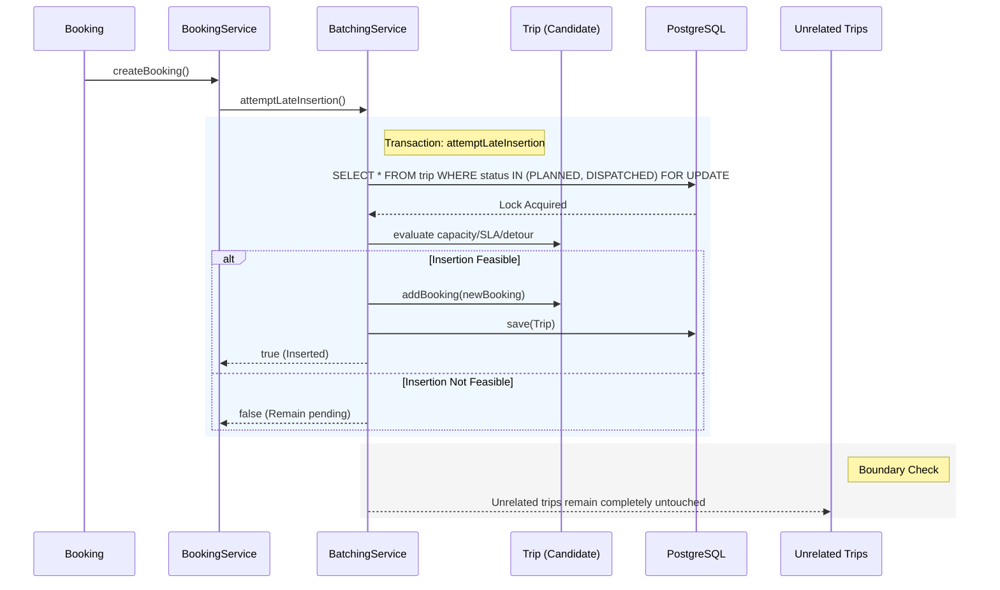
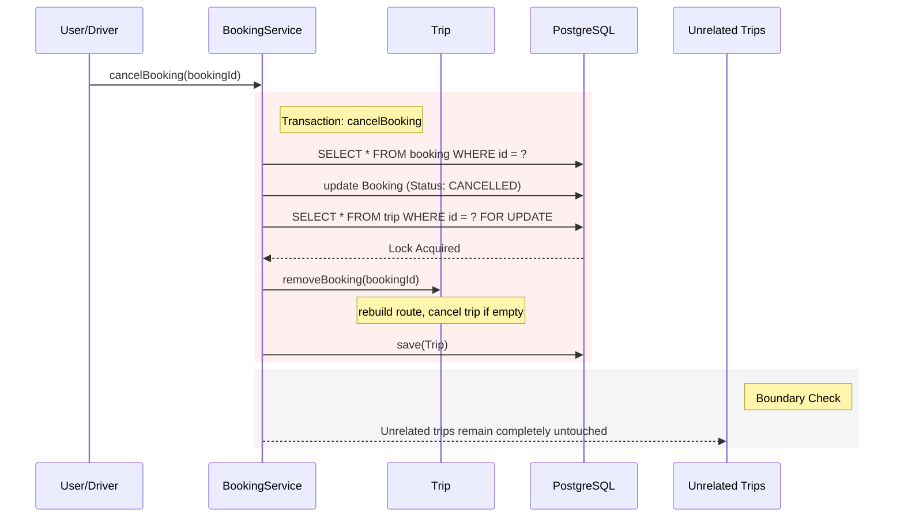

# Trip Mutation Flows

These flows illustrate how active trips can be mutated dynamically through late requests or cancellations, and how concurrent safety is maintained.

## Late Request Insertion

When a new booking is requested, the system evaluates if it can be inserted into an existing candidate trip without violating capacity, SLA, or detour constraints.

## Booking Cancellation (Local Replan)

If a booking assigned to a trip is cancelled, the trip is replanned locally by removing the booking's stops.

